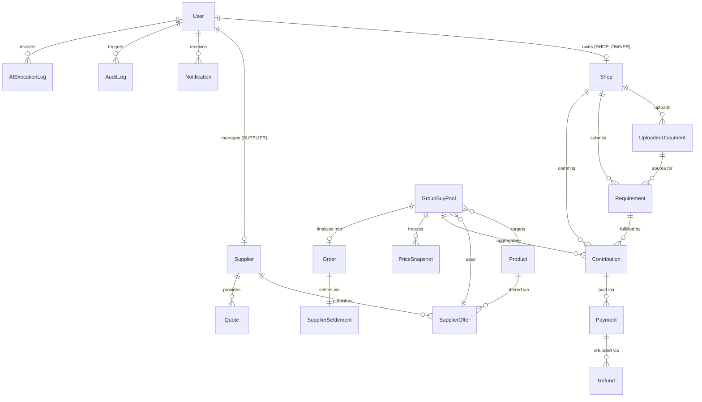

# Database Schemas & Data Dictionary — Aap Ki Dukan (CoBuy AI)

---

## 1. Database Architecture & Design Principles

* **Database Engine:** MongoDB 6.0+ / Atlas Replica Set with Mongoose 8.x ODM.
* **Monetary Precision:** All currency amounts are stored as **integers in minor currency units** (e.g., Paise for `INR` where $₹100.00 = 10000\text{ paise}$, or Cents for `USD` where $\$100.00 = 10000\text{ cents}$). No floating-point numbers are ever used for money.
* **Concurrency & Atomicity:** All multi-record mutations (joining a pool, capturing a payment, locking a pool at $MOQ_W$, expiring a pool at 72 hours, or initiating refunds) execute inside **MongoDB Multi-Document ACID Transactions** with optimistic concurrency versioning (`optimisticConcurrency: true`).
* **Complete Entity Set (18 Collections):**
  1. `User`
  2. `Shop`
  3. `Supplier`
  4. `UploadedDocument`
  5. `Requirement`
  6. `Product`
  7. `SupplierOffer`
  8. `Quote`
  9. `GroupBuyPool`
  10. `Contribution`
  11. `PriceSnapshot`
  12. `Payment`
  13. `Refund`
  14. `Order`
  15. `SupplierSettlement`
  16. `Notification`
  17. `AuditLog`
  18. `AIExecutionLog`

---

## 2. Entity-Relationship Overview



---

## 3. Complete Mongoose Schemas (All 18 Models)

### 3.1 `User` Model (`server/src/models/User.model.js`)

```javascript
import mongoose from 'mongoose';

const userSchema = new mongoose.Schema(
  {
    name: { type: String, required: true, trim: true, maxlength: 120 },
    email: {
      type: String,
      required: true,
      unique: true,
      lowercase: true,
      trim: true,
      index: true,
    },
    passwordHash: { type: String, required: true, select: false },
    role: {
      type: String,
      enum: ['SHOP_OWNER', 'SUPPLIER', 'ADMIN', 'REVIEWER'],
      default: 'SHOP_OWNER',
      required: true,
      index: true,
    },
    status: {
      type: String,
      enum: ['ACTIVE', 'DISABLED', 'PENDING_VERIFICATION'],
      default: 'ACTIVE',
      required: true,
    },
    lastLoginAt: { type: Date, default: null },
  },
  { timestamps: true }
);

export const User = mongoose.model('User', userSchema);
```

---

### 3.2 `Shop` Model (`server/src/models/Shop.model.js`)

```javascript
import mongoose from 'mongoose';

const shopSchema = new mongoose.Schema(
  {
    ownerUserId: {
      type: mongoose.Schema.Types.ObjectId,
      ref: 'User',
      required: true,
      unique: true,
      index: true,
    },
    name: { type: String, required: true, trim: true, maxlength: 150 },
    businessType: {
      type: String,
      enum: ['KIRANA_RETAIL', 'CAFE', 'BAKERY', 'RESTAURANT', 'SUPERMARKET', 'OTHER'],
      default: 'KIRANA_RETAIL',
      required: true,
    },
    deliveryArea: { type: String, required: true, trim: true, index: true }, // e.g., "Lucknow", "Nagpur"
    deliveryAddress: {
      street: { type: String, trim: true },
      city: { type: String, required: true, trim: true },
      state: { type: String, required: true, trim: true },
      postalCode: { type: String, required: true, trim: true },
      country: { type: String, default: 'IN', trim: true },
    },
    contactDetails: {
      phone: { type: String, trim: true },
      whatsapp: { type: String, trim: true },
      gstin: { type: String, trim: true, default: null },
    },
    preferredCurrency: { type: String, default: 'INR', enum: ['INR', 'USD'] },
  },
  { timestamps: true }
);

export const Shop = mongoose.model('Shop', shopSchema);
```

---

### 3.3 `Supplier` Model (`server/src/models/Supplier.model.js`)

```javascript
import mongoose from 'mongoose';

const supplierSchema = new mongoose.Schema(
  {
    ownerUserId: {
      type: mongoose.Schema.Types.ObjectId,
      ref: 'User',
      default: null,
      index: true,
    },
    name: { type: String, required: true, trim: true, maxlength: 160, index: true },
    contactReference: {
      contactPerson: { type: String, trim: true },
      email: { type: String, trim: true, lowercase: true },
      phone: { type: String, trim: true },
      address: { type: String, trim: true },
    },
    serviceAreas: [{ type: String, required: true, trim: true, index: true }],
    verificationStatus: {
      type: String,
      enum: ['VERIFIED', 'UNVERIFIED', 'DEMO_ONLY', 'UNDER_REVIEW'],
      default: 'DEMO_ONLY',
      required: true,
      index: true,
    },
    activeStatus: {
      type: String,
      enum: ['ACTIVE', 'INACTIVE', 'SUSPENDED'],
      default: 'ACTIVE',
      required: true,
      index: true,
    },
    dataSourceType: {
      type: String,
      enum: ['SEEDED_DEMO', 'SUPPLIER_SUBMITTED', 'VERIFIED_LIVE', 'EXTERNAL_API'],
      default: 'SEEDED_DEMO',
      required: true,
    },
  },
  { timestamps: true }
);

export const Supplier = mongoose.model('Supplier', supplierSchema);
```

---

### 3.4 `UploadedDocument` Model (`server/src/models/UploadedDocument.model.js`)

```javascript
import mongoose from 'mongoose';

const uploadedDocumentSchema = new mongoose.Schema(
  {
    uploadedByUserId: {
      type: mongoose.Schema.Types.ObjectId,
      ref: 'User',
      required: true,
      index: true,
    },
    shopId: {
      type: mongoose.Schema.Types.ObjectId,
      ref: 'Shop',
      required: true,
      index: true,
    },
    originalFilename: { type: String, required: true, trim: true },
    storageKey: { type: String, required: true, unique: true }, // Randomized safe UUID filename
    storageMode: { type: String, enum: ['LOCAL', 'OBJECT_STORAGE'], default: 'LOCAL' },
    mimeType: {
      type: String,
      enum: ['application/pdf', 'image/png', 'image/jpeg', 'image/webp', 'text/csv'],
      required: true,
    },
    sizeBytes: { type: Number, required: true, max: 10 * 1024 * 1024 },
    sha256Hash: { type: String, required: true },
    status: {
      type: String,
      enum: ['STORED', 'PROCESSED', 'FAILED_VALIDATION', 'DELETED'],
      default: 'STORED',
      required: true,
    },
    retentionExpiresAt: { type: Date, required: true, index: true },
  },
  { timestamps: true }
);

export const UploadedDocument = mongoose.model('UploadedDocument', uploadedDocumentSchema);
```

---

### 3.5 `Requirement` Model (`server/src/models/Requirement.model.js`)

```javascript
import mongoose from 'mongoose';

const requirementAttributeSnapshotSchema = new mongoose.Schema(
  {
    productName: { type: String, trim: true, default: null },
    category: { type: String, trim: true, default: null },
    requestedQuantity: { type: Number, min: 1, default: null },
    quantityUnit: { type: String, trim: true, default: null }, // e.g., "BOX", "CARTON", "BAG"
    packSize: { type: String, trim: true, default: null },     // e.g., "1000 pieces per box"
    material: { type: String, trim: true, default: null },     // e.g., "Food-safe PE-lined paper"
    capacityOrSize: { type: String, trim: true, default: null }, // e.g., "12 oz"
    foodSafeRequired: { type: Boolean, default: null },
    brandConstraint: { type: String, trim: true, default: null },
    requiredBy: { type: Date, default: null },
    deliveryArea: { type: String, trim: true, default: null },
    additionalSpecifications: { type: Map, of: String, default: {} },
  },
  { _id: false }
);

const requirementSchema = new mongoose.Schema(
  {
    shopId: {
      type: mongoose.Schema.Types.ObjectId,
      ref: 'Shop',
      required: true,
      index: true,
    },
    createdByUserId: {
      type: mongoose.Schema.Types.ObjectId,
      ref: 'User',
      required: true,
    },
    sourceType: {
      type: String,
      enum: ['FORM', 'TEXT', 'IMAGE', 'PDF', 'CSV'],
      required: true,
    },
    originalDescription: { type: String, trim: true, maxlength: 5000, default: '' },
    uploadedDocumentId: {
      type: mongoose.Schema.Types.ObjectId,
      ref: 'UploadedDocument',
      default: null,
    },
    // AI-Extracted Output (Untrusted until user confirms)
    extractedFields: { type: requirementAttributeSnapshotSchema, default: () => ({}) },
    // Authoritative User-Reviewed & Confirmed Fields
    confirmedFields: { type: requirementAttributeSnapshotSchema, default: () => ({}) },
    // Flattened top-level indexed fields populated on confirmation
    productName: { type: String, trim: true, index: true },
    category: { type: String, trim: true, index: true },
    requestedQuantity: { type: Number, min: 1 },
    quantityUnit: { type: String, trim: true, uppercase: true },
    packSize: { type: String, trim: true },
    requiredBy: { type: Date, default: null },
    deliveryArea: { type: String, trim: true, index: true },
    uncertainFields: [{ type: String }],
    confidenceScore: { type: Number, min: 0, max: 1, default: null },
    extractionNotes: { type: String, default: null },
    status: {
      type: String,
      enum: [
        'DRAFT',
        'PROCESSING',
        'NEEDS_REVIEW',
        'CONFIRMED',
        'FAILED_EXTRACTION',
        'REJECTED',
        'ARCHIVED',
      ],
      default: 'DRAFT',
      required: true,
      index: true,
    },
    confirmedByUserId: { type: mongoose.Schema.Types.ObjectId, ref: 'User', default: null },
    confirmedAt: { type: Date, default: null },
  },
  { timestamps: true }
);

requirementSchema.index({ shopId: 1, status: 1, createdAt: -1 });

export const Requirement = mongoose.model('Requirement', requirementSchema);
```

---

### 3.6 `Product` Model (`server/src/models/Product.model.js`)

```javascript
import mongoose from 'mongoose';

const productSchema = new mongoose.Schema(
  {
    canonicalName: { type: String, required: true, trim: true, index: true },
    category: { type: String, required: true, trim: true, index: true },
    baseUnit: {
      type: String,
      required: true,
      uppercase: true,
      trim: true, // e.g., "BOX", "BAG", "CARTON", "UNIT"
    },
    packSizeDescription: { type: String, required: true, trim: true }, // e.g., "1000 cups / box"
    unitsPerPack: { type: Number, required: true, min: 1, default: 1 },
    specifications: {
      material: { type: String, required: true, trim: true },
      capacityOrSize: { type: String, required: true, trim: true },
      foodSafe: { type: Boolean, default: false },
      certifications: [{ type: String, trim: true }],
      grade: { type: String, trim: true, default: 'STANDARD' },
    },
    synonyms: [{ type: String, trim: true }],
    brand: { type: String, trim: true, default: 'GENERIC' },
    isActive: { type: Boolean, default: true, index: true },
  },
  { timestamps: true }
);

productSchema.index({ category: 1, 'specifications.material': 1, 'specifications.capacityOrSize': 1 });

export const Product = mongoose.model('Product', productSchema);
```

---

### 3.7 `SupplierOffer` Model (`server/src/models/SupplierOffer.model.js`)

Includes the **Wholesaler MOQ ($MOQ_W$)**, **Retailer Minimum MOQ Percentage ($p_{\min}$, default $20\%$)**, and **Retailer Step Increment Percentage ($p_{\text{step}}$, default $1\%$)**.

```javascript
import mongoose from 'mongoose';

const quantityTierSchema = new mongoose.Schema(
  {
    minQuantity: { type: Number, required: true, min: 1 },
    maxQuantity: { type: Number, default: null }, // null = unlimited
    unitPriceMinor: { type: Number, required: true, min: 1 }, // In paise/cents
  },
  { _id: false }
);

const supplierOfferSchema = new mongoose.Schema(
  {
    supplierId: {
      type: mongoose.Schema.Types.ObjectId,
      ref: 'Supplier',
      required: true,
      index: true,
    },
    productId: {
      type: mongoose.Schema.Types.ObjectId,
      ref: 'Product',
      required: true,
      index: true,
    },
    supplierProductDescription: { type: String, required: true, trim: true },
    packUnit: { type: String, required: true, uppercase: true, trim: true }, // e.g., "BOX", "UNIT"
    packSize: { type: String, required: true, trim: true },
    currency: { type: String, required: true, default: 'INR', enum: ['INR', 'USD'] },
    baseUnitPriceMinor: { type: Number, required: true, min: 1 }, // e.g., 10000 paise = ₹100.00
    quantityTiers: { type: [quantityTierSchema], default: [] },

    // Wholesaler & Retailer MOQ + Step Multiple Rules
    minimumOrderQuantity: { type: Number, required: true, min: 1 }, // Wholesaler MOQ_W (e.g., 1000)
    retailerMoqPercentage: {
      type: Number,
      required: true,
      min: 1,
      max: 100,
      default: 20, // Default 20% of Wholesaler MOQ (e.g., min 200 when MOQ_W = 1000)
    },
    retailerStepPercentage: {
      type: Number,
      required: true,
      min: 0.1,
      max: 100,
      default: 1, // Default 1% of Wholesaler MOQ (e.g., multiple of 10 when MOQ_W = 1000)
    },
    minRetailerQuantityOverride: { type: Number, min: 1, default: null },
    quantityStepMultipleOverride: { type: Number, min: 1, default: null },
    acceptsUnderMoqOrders: { type: Boolean, default: false },

    deliveryAreas: [{ type: String, required: true, trim: true, index: true }],
    leadTimeDays: { type: Number, required: true, min: 1 },
    shippingTerms: { type: String, required: true, trim: true },
    flatShippingCostMinor: { type: Number, min: 0, default: null }, // null = excluded/pending
    shippingAllocationMethod: {
      type: String,
      enum: ['PER_UNIT', 'PER_WEIGHT', 'EQUAL_SHARE'],
      default: 'PER_UNIT',
    },
    taxInclusion: {
      type: String,
      enum: ['GST_INCLUDED', 'GST_EXCLUDED', 'TAX_PENDING'],
      default: 'GST_EXCLUDED',
    },
    availabilityStatus: {
      type: String,
      enum: ['IN_STOCK', 'MADE_TO_ORDER', 'LOW_STOCK', 'OUT_OF_STOCK'],
      default: 'IN_STOCK',
    },
    quoteTimestamp: { type: Date, required: true, default: Date.now },
    expiresAt: { type: Date, required: true, index: true },
    dataSourceType: {
      type: String,
      enum: ['SEEDED_DEMO', 'SUPPLIER_SUBMITTED', 'VERIFIED_LIVE', 'EXTERNAL_API'],
      default: 'SEEDED_DEMO',
      required: true,
    },
    verificationStatus: {
      type: String,
      enum: ['VERIFIED', 'UNVERIFIED', 'DEMO_SAMPLE'],
      default: 'DEMO_SAMPLE',
      required: true,
    },
    isActive: { type: Boolean, default: true, index: true },
  },
  { timestamps: true }
);

supplierOfferSchema.index({ productId: 1, isActive: 1, expiresAt: 1 });

export const SupplierOffer = mongoose.model('SupplierOffer', supplierOfferSchema);
```

---

### 3.8 `Quote` Model (`server/src/models/Quote.model.js`)

```javascript
import mongoose from 'mongoose';

const quoteSchema = new mongoose.Schema(
  {
    supplierId: {
      type: mongoose.Schema.Types.ObjectId,
      ref: 'Supplier',
      required: true,
      index: true,
    },
    productId: {
      type: mongoose.Schema.Types.ObjectId,
      ref: 'Product',
      required: true,
    },
    supplierOfferId: {
      type: mongoose.Schema.Types.ObjectId,
      ref: 'SupplierOffer',
      default: null,
    },
    poolId: {
      type: mongoose.Schema.Types.ObjectId,
      ref: 'GroupBuyPool',
      default: null,
      index: true,
    },
    requestedByUserId: {
      type: mongoose.Schema.Types.ObjectId,
      ref: 'User',
      required: true,
    },
    quotedQuantity: { type: Number, required: true, min: 1 },
    currency: { type: String, required: true, default: 'INR', enum: ['INR', 'USD'] },
    unitPriceMinor: { type: Number, min: 1, default: null },
    quantityTiers: [
      {
        minQuantity: { type: Number, required: true },
        unitPriceMinor: { type: Number, required: true },
      },
    ],
    shippingCostMinor: { type: Number, min: 0, default: null },
    shippingConditions: { type: String, trim: true, default: '' },
    taxInclusion: {
      type: String,
      enum: ['GST_INCLUDED', 'GST_EXCLUDED', 'TAX_PENDING'],
      default: 'GST_EXCLUDED',
    },
    leadTimeDays: { type: Number, min: 1, default: null },
    validUntil: { type: Date, default: null, index: true },
    source: {
      type: String,
      enum: ['SEEDED_DEMO', 'SUPPLIER_PORTAL', 'ADMIN_MANUAL_ENTRY'],
      default: 'SUPPLIER_PORTAL',
    },
    status: {
      type: String,
      enum: ['REQUESTED', 'PROVIDED', 'ACCEPTED', 'EXPIRED', 'REJECTED'],
      default: 'REQUESTED',
      required: true,
      index: true,
    },
    notes: { type: String, trim: true, default: '' },
  },
  { timestamps: true }
);

export const Quote = mongoose.model('Quote', quoteSchema);
```

---

### 3.9 `GroupBuyPool` Model (`server/src/models/GroupBuyPool.model.js`)

```javascript
import mongoose from 'mongoose';

const groupBuyPoolSchema = new mongoose.Schema(
  {
    title: { type: String, required: true, trim: true, maxlength: 180 },
    productId: {
      type: mongoose.Schema.Types.ObjectId,
      ref: 'Product',
      required: true,
      index: true,
    },
    supplierOfferId: {
      type: mongoose.Schema.Types.ObjectId,
      ref: 'SupplierOffer',
      required: true,
      index: true,
    },
    activeQuoteId: {
      type: mongoose.Schema.Types.ObjectId,
      ref: 'Quote',
      default: null,
    },
    deliveryArea: { type: String, required: true, trim: true, index: true },
    currency: { type: String, required: true, default: 'INR', enum: ['INR', 'USD'] },
    packUnit: { type: String, required: true, uppercase: true, trim: true },

    // Wholesaler MOQ, Retailer MOQ (20%), and Step Multiple (1%)
    targetMoq: { type: Number, required: true, min: 1 }, // Wholesaler MOQ_W (e.g., 1000)
    retailerMoqPercentage: { type: Number, required: true, default: 20 },
    retailerStepPercentage: { type: Number, required: true, default: 1 },
    minRetailerQuantity: { type: Number, required: true, min: 1 }, // Derived MOQ_R (e.g., 200)
    quantityStepMultiple: { type: Number, required: true, min: 1 }, // Derived Step (e.g., 10)

    // Real-Time Backend-Calculated Totals
    totalEligibleQuantity: { type: Number, required: true, default: 0, min: 0 },
    participantCount: { type: Number, required: true, default: 0, min: 0 },
    baseUnitPriceMinor: { type: Number, required: true, min: 1 },
    currentUnitPriceMinor: { type: Number, required: true, min: 1 },
    estimatedMerchandiseTotalMinor: { type: Number, required: true, default: 0, min: 0 },
    shippingCostMinor: { type: Number, default: null },
    shippingAllocationMethod: {
      type: String,
      enum: ['PER_UNIT', 'PER_WEIGHT', 'EQUAL_SHARE'],
      default: 'PER_UNIT',
    },
    paymentPolicy: {
      type: String,
      enum: ['PAY_AT_JOIN', 'PAY_AFTER_APPROVAL'],
      default: 'PAY_AT_JOIN',
    },

    // Authoritative 72-Hour Timer & 24-Hour Under-MOQ Decision Timestamps
    publishedAt: { type: Date, required: true, default: Date.now },
    deadline: { type: Date, required: true, index: true }, // publishedAt + 72 hours
    lockedAt: { type: Date, default: null },
    lockReason: {
      type: String,
      enum: ['NONE', 'MOQ_REACHED_EARLY', 'EXPIRED_72H_UNDER_MOQ', 'ADMIN_LOCKED'],
      default: 'NONE',
    },
    decisionDeadline: { type: Date, default: null, index: true }, // lockedAt + 24 hours

    // Under-MOQ Feasibility & AI Recommendation
    supplierUnderMoqStatus: {
      type: String,
      enum: [
        'NOT_APPLICABLE',
        'AWAITING_SUPPLIER',
        'ACCEPTED_SUB_MOQ',
        'REVISED_QUOTE_PROVIDED',
        'REJECTED_SUB_MOQ',
      ],
      default: 'NOT_APPLICABLE',
    },
    aiUnderMoqRecommendation: {
      suggestedAction: {
        type: String,
        enum: ['PROCEED', 'WAIT_FOR_REVISED_QUOTE', 'CANCEL', null],
        default: null,
      },
      explanation: { type: String, default: null },
      supportingFigures: { type: mongoose.Schema.Types.Mixed, default: null },
      uncertainties: [{ type: String }],
      generatedAt: { type: Date, default: null },
    },

    // Versioned Price Snapshot & Lifecycle State
    priceBreakdownVersion: { type: Number, required: true, default: 0 },
    latestPriceSnapshotId: {
      type: mongoose.Schema.Types.ObjectId,
      ref: 'PriceSnapshot',
      default: null,
    },
    state: {
      type: String,
      enum: [
        'DRAFT',
        'RECRUITING',
        'MOQ_REACHED',
        'UNDER_MOQ_DECISION_PENDING',
        'AWAITING_SUPPLIER_UNDER_MOQ_FEASIBILITY',
        'AWAITING_REVISED_QUOTE_APPROVAL',
        'AWAITING_APPROVALS',
        'AWAITING_PAYMENT',
        'FUNDED',
        'SUPPLIER_ORDER_PENDING',
        'ORDERED',
        'FULFILLED',
        'EXPIRED',
        'CANCELLED',
        'FAILED',
        'NEEDS_REVIEW',
      ],
      default: 'RECRUITING',
      required: true,
      index: true,
    },
    closedAt: { type: Date, default: null },
    closureReason: { type: String, default: null },
    createdByUserId: {
      type: mongoose.Schema.Types.ObjectId,
      ref: 'User',
      required: true,
    },
  },
  { timestamps: true, optimisticConcurrency: true }
);

groupBuyPoolSchema.index({ state: 1, deadline: 1 });
groupBuyPoolSchema.index({ state: 1, decisionDeadline: 1 });

export const GroupBuyPool = mongoose.model('GroupBuyPool', groupBuyPoolSchema);
```

---

### 3.10 `Contribution` Model (`server/src/models/Contribution.model.js`)

```javascript
import mongoose from 'mongoose';

const contributionSchema = new mongoose.Schema(
  {
    poolId: {
      type: mongoose.Schema.Types.ObjectId,
      ref: 'GroupBuyPool',
      required: true,
      index: true,
    },
    shopId: {
      type: mongoose.Schema.Types.ObjectId,
      ref: 'Shop',
      required: true,
      index: true,
    },
    requirementId: {
      type: mongoose.Schema.Types.ObjectId,
      ref: 'Requirement',
      required: true,
    },
    createdByUserId: {
      type: mongoose.Schema.Types.ObjectId,
      ref: 'User',
      required: true,
    },
    quantity: { type: Number, required: true, min: 1 }, // Validated against MOQ_R & Step
    unit: { type: String, required: true, uppercase: true, trim: true },
    approvedSubstitution: {
      isSubstituted: { type: Boolean, default: false },
      substitutionNote: { type: String, default: null },
      approvedByUserId: { type: mongoose.Schema.Types.ObjectId, ref: 'User', default: null },
      approvedAt: { type: Date, default: null },
    },

    // Authoritative Financial Breakdown (in minor units)
    unitPriceMinor: { type: Number, required: true, min: 1 },
    estimatedMerchandiseShareMinor: { type: Number, required: true, min: 0 },
    estimatedShippingShareMinor: { type: Number, required: true, default: 0, min: 0 },
    roundingAdjustmentMinor: { type: Number, required: true, default: 0 },
    finalTotalPayableMinor: { type: Number, required: true, min: 0 },
    verifiedSavingsMinor: { type: Number, required: true, default: 0, min: 0 },

    // Cumulative Payment & Refund Ledger for this Contribution
    totalPaidMinor: { type: Number, required: true, default: 0, min: 0 },
    totalRefundedMinor: { type: Number, required: true, default: 0, min: 0 },

    // Snapshot Approval Tracking
    approvalStatus: {
      type: String,
      enum: [
        'NOT_REQUIRED_YET',
        'PENDING_APPROVAL',
        'APPROVED',
        'INVALIDATED_BY_CHANGE',
        'REJECTED',
      ],
      default: 'NOT_REQUIRED_YET',
      required: true,
    },
    approvedPriceSnapshotId: {
      type: mongoose.Schema.Types.ObjectId,
      ref: 'PriceSnapshot',
      default: null,
    },
    approvedAt: { type: Date, default: null },

    // 24-Hour Under-MOQ Buyer Decision Tracking
    underMoqDecision: {
      type: String,
      enum: ['NOT_APPLICABLE', 'PENDING', 'PROCEED', 'CANCEL', 'EXPIRED_NO_RESPONSE'],
      default: 'NOT_APPLICABLE',
      required: true,
    },
    underMoqDecisionAt: { type: Date, default: null },

    state: {
      type: String,
      enum: [
        'PENDING_PAYMENT',
        'ACTIVE',
        'WITHDRAWN',
        'CANCELLED_UNDER_MOQ',
        'REFUNDED',
        'FINALIZED',
      ],
      default: 'PENDING_PAYMENT',
      required: true,
      index: true,
    },
    withdrawnAt: { type: Date, default: null },
  },
  { timestamps: true, optimisticConcurrency: true }
);

// Prevent duplicate active contributions by the same shop in the same pool
contributionSchema.index(
  { poolId: 1, shopId: 1 },
  {
    unique: true,
    partialFilterExpression: { state: { $in: ['PENDING_PAYMENT', 'ACTIVE', 'FINALIZED'] } },
  }
);

export const Contribution = mongoose.model('Contribution', contributionSchema);
```

---

### 3.11 `PriceSnapshot` Model (`server/src/models/PriceSnapshot.model.js`)

```javascript
import mongoose from 'mongoose';

const snapshotMemberShareSchema = new mongoose.Schema(
  {
    contributionId: {
      type: mongoose.Schema.Types.ObjectId,
      ref: 'Contribution',
      required: true,
    },
    shopId: { type: mongoose.Schema.Types.ObjectId, ref: 'Shop', required: true },
    quantity: { type: Number, required: true },
    unit: { type: String, required: true },
    appliedUnitPriceMinor: { type: Number, required: true },
    merchandiseShareMinor: { type: Number, required: true },
    shippingShareMinor: { type: Number, required: true },
    roundingAdjustmentMinor: { type: Number, required: true, default: 0 },
    totalPayableMinor: { type: Number, required: true },
    verifiedSavingsMinor: { type: Number, required: true, default: 0 },
  },
  { _id: false }
);

const priceSnapshotSchema = new mongoose.Schema(
  {
    poolId: {
      type: mongoose.Schema.Types.ObjectId,
      ref: 'GroupBuyPool',
      required: true,
      index: true,
    },
    version: { type: Number, required: true, min: 1 },
    supplierOfferId: {
      type: mongoose.Schema.Types.ObjectId,
      ref: 'SupplierOffer',
      required: true,
    },
    quoteId: { type: mongoose.Schema.Types.ObjectId, ref: 'Quote', default: null },
    currency: { type: String, required: true, enum: ['INR', 'USD'] },
    totalEligibleQuantity: { type: Number, required: true },
    baseUnitPriceMinor: { type: Number, required: true },
    appliedUnitPriceMinor: { type: Number, required: true },
    merchandiseTotalMinor: { type: Number, required: true },
    shippingCostMinor: { type: Number, default: null },
    shippingStatus: {
      type: String,
      enum: ['KNOWN', 'EXCLUDED_OR_PENDING'],
      required: true,
    },
    shippingAllocationMethod: {
      type: String,
      enum: ['PER_UNIT', 'PER_WEIGHT', 'EQUAL_SHARE'],
      required: true,
    },
    taxInclusion: { type: String, required: true },
    groupTotalPayableMinor: { type: Number, required: true },
    baselineComparisonSource: { type: String, required: true },
    baselineTimestamp: { type: Date, required: true },
    memberShares: { type: [snapshotMemberShareSchema], required: true },
    isSuperseded: { type: Boolean, default: false },
  },
  { timestamps: true }
);

priceSnapshotSchema.index({ poolId: 1, version: -1 }, { unique: true });

export const PriceSnapshot = mongoose.model('PriceSnapshot', priceSnapshotSchema);
```

---

### 3.12 `Payment` Model (`server/src/models/Payment.model.js`)

```javascript
import mongoose from 'mongoose';

const paymentSchema = new mongoose.Schema(
  {
    poolId: {
      type: mongoose.Schema.Types.ObjectId,
      ref: 'GroupBuyPool',
      required: true,
      index: true,
    },
    contributionId: {
      type: mongoose.Schema.Types.ObjectId,
      ref: 'Contribution',
      required: true,
      index: true,
    },
    shopId: {
      type: mongoose.Schema.Types.ObjectId,
      ref: 'Shop',
      required: true,
      index: true,
    },
    payerUserId: {
      type: mongoose.Schema.Types.ObjectId,
      ref: 'User',
      required: true,
    },
    priceSnapshotId: {
      type: mongoose.Schema.Types.ObjectId,
      ref: 'PriceSnapshot',
      default: null,
    },
    paymentPurpose: {
      type: String,
      enum: [
        'INITIAL_JOIN',
        'QUANTITY_INCREASE_DELTA',
        'POST_APPROVAL_FINAL',
        'UNDER_MOQ_SURCHARGE',
      ],
      required: true,
    },
    provider: {
      type: String,
      enum: ['PAYPAL_SANDBOX', 'MOCK_DEV'],
      default: 'PAYPAL_SANDBOX',
      required: true,
    },
    providerOrderId: { type: String, required: true, unique: true, index: true },
    providerCaptureId: { type: String, unique: true, sparse: true, index: true },
    idempotencyKey: { type: String, required: true, unique: true, index: true },
    amountMinor: { type: Number, required: true, min: 1 },
    currency: { type: String, required: true, enum: ['INR', 'USD'] },
    paymentStatus: {
      type: String,
      enum: [
        'CREATED',
        'BUYER_ACTION_REQUIRED',
        'APPROVED',
        'CAPTURE_PENDING',
        'PAID',
        'CANCELLED',
        'FAILED',
        'PARTIALLY_REFUNDED',
        'REFUNDED',
        'UNKNOWN',
        'NEEDS_REVIEW',
      ],
      default: 'CREATED',
      required: true,
      index: true,
    },
    isTestTransaction: { type: Boolean, default: true, required: true },
    approvedAt: { type: Date, default: null },
    capturedAt: { type: Date, default: null },
    lastReconciledAt: { type: Date, default: null },
    safeErrorCode: { type: String, default: null },
    reconciliationNotes: { type: String, default: null },
  },
  { timestamps: true }
);

export const Payment = mongoose.model('Payment', paymentSchema);
```

---

### 3.13 `Refund` Model (`server/src/models/Refund.model.js`)

```javascript
import mongoose from 'mongoose';

const refundSchema = new mongoose.Schema(
  {
    paymentId: {
      type: mongoose.Schema.Types.ObjectId,
      ref: 'Payment',
      required: true,
      index: true,
    },
    poolId: {
      type: mongoose.Schema.Types.ObjectId,
      ref: 'GroupBuyPool',
      required: true,
      index: true,
    },
    contributionId: {
      type: mongoose.Schema.Types.ObjectId,
      ref: 'Contribution',
      required: true,
      index: true,
    },
    shopId: {
      type: mongoose.Schema.Types.ObjectId,
      ref: 'Shop',
      required: true,
      index: true,
    },
    amountMinor: { type: Number, required: true, min: 1 },
    currency: { type: String, required: true, enum: ['INR', 'USD'] },
    reason: {
      type: String,
      enum: [
        'BUYER_WITHDRAWAL',
        'QUANTITY_REDUCTION',
        'TIER_PRICE_DROP_SAVINGS',
        'POOL_CANCELLED',
        'UNDER_MOQ_BUYER_CANCEL',
        'UNDER_MOQ_NO_RESPONSE',
        'SUPPLIER_REJECTED',
        'EXTRA_PAYMENT_FAILURE_ROLLBACK',
      ],
      required: true,
    },
    provider: {
      type: String,
      enum: ['PAYPAL_SANDBOX', 'MOCK_DEV'],
      default: 'PAYPAL_SANDBOX',
    },
    providerRefundId: { type: String, unique: true, sparse: true, index: true },
    idempotencyKey: { type: String, required: true, unique: true, index: true },
    status: {
      type: String,
      enum: ['REQUESTED', 'PROCESSING', 'COMPLETED', 'FAILED'],
      default: 'REQUESTED',
      required: true,
      index: true,
    },
    completedAt: { type: Date, default: null },
    safeErrorDetails: { type: String, default: null },
  },
  { timestamps: true }
);

export const Refund = mongoose.model('Refund', refundSchema);
```

---

### 3.14 `Order` Model (`server/src/models/Order.model.js`)

```javascript
import mongoose from 'mongoose';

const memberOrderAllocationSchema = new mongoose.Schema(
  {
    contributionId: {
      type: mongoose.Schema.Types.ObjectId,
      ref: 'Contribution',
      required: true,
    },
    shopId: { type: mongoose.Schema.Types.ObjectId, ref: 'Shop', required: true },
    shopName: { type: String, required: true },
    quantity: { type: Number, required: true },
    unit: { type: String, required: true },
    unitPriceMinor: { type: Number, required: true },
    merchandiseShareMinor: { type: Number, required: true },
    shippingShareMinor: { type: Number, required: true },
    totalPaidMinor: { type: Number, required: true },
    deliveryStatus: {
      type: String,
      enum: ['PENDING', 'DISPATCHED', 'DELIVERED', 'CANCELLED'],
      default: 'PENDING',
    },
  },
  { _id: false }
);

const orderSchema = new mongoose.Schema(
  {
    orderNumber: { type: String, required: true, unique: true, index: true }, // e.g., "AKD-2026-0001"
    poolId: {
      type: mongoose.Schema.Types.ObjectId,
      ref: 'GroupBuyPool',
      required: true,
      unique: true,
      index: true,
    },
    supplierId: {
      type: mongoose.Schema.Types.ObjectId,
      ref: 'Supplier',
      required: true,
      index: true,
    },
    productId: {
      type: mongoose.Schema.Types.ObjectId,
      ref: 'Product',
      required: true,
    },
    supplierOfferId: {
      type: mongoose.Schema.Types.ObjectId,
      ref: 'SupplierOffer',
      required: true,
    },
    priceSnapshotId: {
      type: mongoose.Schema.Types.ObjectId,
      ref: 'PriceSnapshot',
      required: true,
    },
    currency: { type: String, required: true, enum: ['INR', 'USD'] },
    totalQuantity: { type: Number, required: true, min: 1 },
    unit: { type: String, required: true },
    merchandiseTotalMinor: { type: Number, required: true },
    shippingTotalMinor: { type: Number, required: true, default: 0 },
    grandTotalMinor: { type: Number, required: true },
    memberOrders: { type: [memberOrderAllocationSchema], required: true },

    // Supplier Confirmation State
    supplierConfirmationStatus: {
      type: String,
      enum: ['PENDING', 'CONFIRMED', 'REJECTED'],
      default: 'PENDING',
      required: true,
    },
    supplierReference: { type: String, default: null },
    isSimulatedConfirmation: { type: Boolean, default: true },
    confirmedAt: { type: Date, default: null },
    expectedDeliveryDate: { type: Date, default: null },

    orderState: {
      type: String,
      enum: [
        'AWAITING_SUPPLIER_CONFIRMATION',
        'CONFIRMED',
        'PROCESSING',
        'SHIPPED',
        'DELIVERED',
        'FULFILLED',
        'CANCELLED',
        'EXCEPTION',
      ],
      default: 'AWAITING_SUPPLIER_CONFIRMATION',
      required: true,
      index: true,
    },
    cancellationReason: { type: String, default: null },
  },
  { timestamps: true }
);

export const Order = mongoose.model('Order', orderSchema);
```

---

### 3.15 `SupplierSettlement` Model (`server/src/models/SupplierSettlement.model.js`)

Strictly separates buyer payment capture from wholesaler settlement (`SIMULATED`, `MANUAL`, or `INTEGRATED`).

```javascript
import mongoose from 'mongoose';

const supplierSettlementSchema = new mongoose.Schema(
  {
    orderId: {
      type: mongoose.Schema.Types.ObjectId,
      ref: 'Order',
      required: true,
      unique: true,
      index: true,
    },
    poolId: {
      type: mongoose.Schema.Types.ObjectId,
      ref: 'GroupBuyPool',
      required: true,
      index: true,
    },
    supplierId: {
      type: mongoose.Schema.Types.ObjectId,
      ref: 'Supplier',
      required: true,
      index: true,
    },
    amountMinor: { type: Number, required: true, min: 0 },
    currency: { type: String, required: true, enum: ['INR', 'USD'] },
    settlementStatus: {
      type: String,
      enum: [
        'NOT_STARTED',
        'SIMULATED',
        'PENDING',
        'CONFIRMED',
        'FAILED',
        'NEEDS_REVIEW',
      ],
      default: 'SIMULATED',
      required: true,
      index: true,
    },
    mode: {
      type: String,
      enum: ['DEMO', 'MANUAL', 'INTEGRATED'],
      default: 'DEMO',
      required: true,
    },
    providerReference: { type: String, default: null },
    confirmedAt: { type: Date, default: null },
    notes: {
      type: String,
      default: 'Simulated supplier settlement for prototype demonstration.',
    },
  },
  { timestamps: true }
);

export const SupplierSettlement = mongoose.model(
  'SupplierSettlement',
  supplierSettlementSchema
);
```

---

### 3.16 `Notification` Model (`server/src/models/Notification.model.js`)

```javascript
import mongoose from 'mongoose';

const notificationSchema = new mongoose.Schema(
  {
    recipientUserId: {
      type: mongoose.Schema.Types.ObjectId,
      ref: 'User',
      required: true,
      index: true,
    },
    shopId: { type: mongoose.Schema.Types.ObjectId, ref: 'Shop', default: null },
    type: {
      type: String,
      enum: [
        'POOL_CREATED',
        'POOL_JOINED',
        'PAYMENT_VERIFIED',
        'PAYMENT_FAILED',
        'QUANTITY_UPDATED',
        'MOQ_MILESTONE',
        'MOQ_REACHED_LOCKED',
        'EXPIRED_72H_UNDER_MOQ',
        'UNDER_MOQ_DECISION_REQUIRED',
        'DECISION_DEADLINE_APPROACHING',
        'SUPPLIER_QUOTE_REVISED',
        'SNAPSHOT_APPROVAL_REQUIRED',
        'APPROVAL_INVALIDATED',
        'REFUND_INITIATED',
        'REFUND_COMPLETED',
        'REFUND_FAILED',
        'ORDER_CONFIRMED',
        'ORDER_REJECTED',
        'ORDER_STATUS_UPDATED',
      ],
      required: true,
    },
    title: { type: String, required: true, trim: true },
    message: { type: String, required: true, trim: true },
    linkUrl: { type: String, required: true, trim: true },
    relatedPoolId: { type: mongoose.Schema.Types.ObjectId, ref: 'GroupBuyPool', default: null },
    relatedOrderId: { type: mongoose.Schema.Types.ObjectId, ref: 'Order', default: null },
    isRead: { type: Boolean, default: false, index: true },
    readAt: { type: Date, default: null },
  },
  { timestamps: true }
);

notificationSchema.index({ recipientUserId: 1, isRead: 1, createdAt: -1 });

export const Notification = mongoose.model('Notification', notificationSchema);
```

---

### 3.17 `AuditLog` Model (`server/src/models/AuditLog.model.js`)

```javascript
import mongoose from 'mongoose';

const auditLogSchema = new mongoose.Schema(
  {
    correlationId: { type: String, required: true, index: true },
    actorId: { type: mongoose.Schema.Types.ObjectId, ref: 'User', default: null, index: true },
    actorRole: {
      type: String,
      enum: ['SHOP_OWNER', 'SUPPLIER', 'ADMIN', 'REVIEWER', 'SYSTEM_SCHEDULER', 'WEBHOOK'],
      required: true,
    },
    action: { type: String, required: true, index: true }, // e.g., "POOL_JOINED", "PAYMENT_CAPTURED", "EARLY_MOQ_LOCK"
    resourceType: {
      type: String,
      enum: [
        'USER',
        'SHOP',
        'SUPPLIER',
        'REQUIREMENT',
        'UPLOAD',
        'OFFER',
        'QUOTE',
        'POOL',
        'CONTRIBUTION',
        'PRICE_SNAPSHOT',
        'PAYMENT',
        'REFUND',
        'ORDER',
        'SETTLEMENT',
      ],
      required: true,
      index: true,
    },
    resourceId: { type: mongoose.Schema.Types.ObjectId, required: true, index: true },
    poolId: { type: mongoose.Schema.Types.ObjectId, ref: 'GroupBuyPool', default: null, index: true },
    orderId: { type: mongoose.Schema.Types.ObjectId, ref: 'Order', default: null, index: true },
    metadata: { type: mongoose.Schema.Types.Mixed, default: {} }, // Scrubbed of secrets/PII
  },
  { timestamps: { createdAt: true, updatedAt: false } }
);

auditLogSchema.index({ poolId: 1, createdAt: -1 });
auditLogSchema.index({ orderId: 1, createdAt: -1 });

export const AuditLog = mongoose.model('AuditLog', auditLogSchema);
```

---

### 3.18 `AIExecutionLog` Model (`server/src/models/AIExecutionLog.model.js`)

```javascript
import mongoose from 'mongoose';

const aiExecutionLogSchema = new mongoose.Schema(
  {
    correlationId: { type: String, required: true, index: true },
    triggeredByUserId: { type: mongoose.Schema.Types.ObjectId, ref: 'User', default: null },
    requirementId: { type: mongoose.Schema.Types.ObjectId, ref: 'Requirement', default: null },
    poolId: { type: mongoose.Schema.Types.ObjectId, ref: 'GroupBuyPool', default: null },
    operation: {
      type: String,
      enum: [
        'EXTRACT_REQUIREMENT',
        'NORMALIZE_PRODUCT',
        'MATCH_PRODUCTS',
        'SUMMARIZE_QUOTES',
        'UNDER_MOQ_RECOMMENDATION',
      ],
      required: true,
      index: true,
    },
    provider: { type: String, required: true }, // e.g., "gemini", "openai", "mock"
    model: { type: String, required: true },
    status: {
      type: String,
      enum: ['SUCCESS', 'SCHEMA_VALIDATION_FAILED', 'TIMEOUT', 'PROVIDER_ERROR', 'FALLBACK_USED'],
      required: true,
      index: true,
    },
    latencyMs: { type: Number, required: true, min: 0 },
    schemaValidated: { type: Boolean, required: true, default: false },
    safeErrorCode: { type: String, default: null },
  },
  { timestamps: { createdAt: true, updatedAt: false } }
);

export const AIExecutionLog = mongoose.model('AIExecutionLog', aiExecutionLogSchema);
```

---

## 4. Seeded Demonstration Datasets (`seedDemoData.js`)

The database seeder creates a coherent, self-contained demonstration dataset with securely hashed passwords:

1. **Seeded Accounts:**
   * **Shop A (`SHOP_OWNER`):** *Hazratganj Artisan Café* (Lucknow) — `cafeA@demo.aapkidukan.in`
   * **Shop B (`SHOP_OWNER`):** *Gomti Bakery & Espresso* (Lucknow) — `bakeryB@demo.aapkidukan.in`
   * **Shop C (`SHOP_OWNER`):** *Awadh Bistro & Roasters* (Lucknow) — `bistroC@demo.aapkidukan.in`
   * **Wholesaler 1 (`SUPPLIER`):** *Bharat EcoPack Wholesalers* (`SEEDED_DEMO`) — `supplier1@demo.aapkidukan.in`
   * **Wholesaler 2 (`SUPPLIER`):** *Northern Foodservice Supplies* (`SEEDED_DEMO`) — `supplier2@demo.aapkidukan.in`
   * **Platform Admin (`ADMIN`):** `admin@demo.aapkidukan.in`
   * **Evaluator (`REVIEWER`):** `reviewer@demo.aapkidukan.in`

2. **Seeded Scenario 1 — Mandatory $₹4,800$ Bulk Tier Unlock Pool:**
   * **Product:** 12-oz Food-Safe PE-Lined Paper Cups ($1000\text{ cups/box}$).
   * **Offer:** Base price $₹100/\text{box}$ ($10000\text{ paise}$); $30\text{–}49\text{ boxes} \rightarrow ₹90/\text{box}$ ($9000\text{ paise}$); $\ge 50\text{ boxes} \rightarrow ₹80/\text{box}$ ($8000\text{ paise}$); Wholesaler MOQ $= 50\text{ boxes}$, Retailer MOQ $= 20\%$ ($10\text{ boxes}$), Step Override $= 5\text{ boxes}$.
   * **Contributions:** Shop A ($20\text{ boxes} \rightarrow ₹1,600$), Shop B ($15\text{ boxes} \rightarrow ₹1,200$), Shop C ($25\text{ boxes} \rightarrow ₹2,000$). Total $= 60\text{ boxes}$ ($₹4,800$).

3. **Seeded Scenario 2 — Wholesaler MOQ $1000$, Retailer MOQ $20\%$ ($200$), Step $1\%$ ($10$) Pool:**
   * **Product:** Wholesale Corrugated Takeout Boxes (Pack Unit: `UNIT`).
   * **Offer:** Wholesaler MOQ $MOQ_W = 1000\text{ units}$, $p_{\min} = 20\% \implies MOQ_R = 200\text{ units}$, $p_{\text{step}} = 1\% \implies \text{Step} = 10\text{ units}$.
   * Demonstrates live validation accepting $200, 210, 220\text{ units}$ and rejecting $< 200$ or non-multiples of $10$.

4. **Seeded Scenario 3 — 72-Hour Expired Under-MOQ Pool in 24-Hour Decision Window:**
   * Pool locked at $600 / 1000\text{ units}$ after 72 hours, showcasing the AI under-MOQ recommendation, explicit **Proceed** vs. **Cancel** buyer actions, revised supplier quote option, and tracked refunds.

5. **Seeded Scenario 4 — Deliberately Incompatible Requirement:**
   * A requirement for *8-oz Non-Food-Safe Polystyrene Cups* that is automatically flagged and blocked from joining the *12-oz Food-Safe Paper Cup* pool without explicit substitution review.