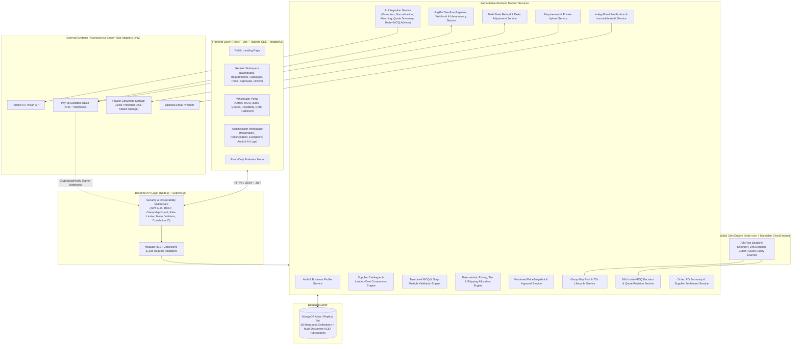

# High-Level Design (HLD) — Aap Ki Dukan (CoBuy AI)
**AI-Assisted B2B Group Procurement Platform for Small Businesses (Retailers & Wholesalers)**

---

## 1. Executive Summary & Product Vision

**Aap Ki Dukan (CoBuy AI)** is an end-to-end, AI-assisted B2B group procurement platform built on the MERN stack. It empowers small independent businesses—kirana stores, retail shops, cafés, bakeries, and restaurants (**Retailers / Shop Owners**)—to combine compatible purchasing requirements so they can qualify for **Wholesaler / Supplier** Minimum Order Quantities ($MOQ_W$), unlock bulk price tiers, and transparently allocate merchandise and shipping costs.

### Core Architectural Philosophy
1. **AI as an Intelligent Assistant:** Hosted AI models extract structured product requirements from natural-language text, uploaded invoices, images, PDFs, or CSV imports; normalize product attributes; suggest compatible supplier offers with explicit match/mismatch explanations; summarize verified quote trade-offs; and provide data-grounded advisory recommendations when group-buy pools expire below the wholesaler's MOQ.
2. **Deterministic Backend as the Single Source of Truth:** The Node.js/Express backend remains the sole authority for Wholesaler MOQ ($MOQ_W$), Retailer Minimum MOQ ($MOQ_R$), step-multiple quantity validations, quantity-tier pricing, shipping cost allocations, versioned pricing snapshots, 72-hour pool timers, 24-hour under-MOQ buyer decision windows, PayPal Sandbox payment verifications, refunds, role-based access control, and order-state transitions.
3. **Zero Fake or Decorative Functionality:** Every visible control, filter, approval, payment flow, and status badge is backed by persistent database records and verified backend logic. Seeded demo catalogue data (`DEMO SAMPLE DATA`), sandbox payments (`TEST TRANSACTION`), and non-integrated supplier payouts (`SIMULATED SETTLEMENT`) carry explicit, transparent disclosure badges.

---

## 2. Unified Architectural Synthesis & Harmonized Business Rules

To ensure a seamless end-to-end procurement lifecycle, all platform capabilities operate under a unified set of harmonized architectural rules:

| Domain Area | Unified Architectural Rule in **Aap Ki Dukan (CoBuy AI)** |
| :--- | :--- |
| **Two-Level MOQ & Step-Multiple Granularity** | Every `SupplierOffer` and `GroupBuyPool` defines a **Wholesaler MOQ** ($MOQ_W$, e.g., $1000\text{ units}$), a **Retailer Minimum MOQ Percentage** ($p_{\min}$, default $20\% \implies \min 200\text{ units}$), and a **Retailer Step Increment Percentage** ($p_{\text{step}}$, default $1\% \implies \text{multiples of } 10\text{ units}$), along with optional explicit integer overrides (`minRetailerQuantityOverride`, `quantityStepMultipleOverride`) for box-level offers (such as $MOQ_W = 50\text{ boxes}$ with contributions of $20, 15, 25\text{ boxes}$). |
| **Two-Phase Financial Commitment & Snapshot Approval** | Pools support a unified commitment flow (`PAY_AT_JOIN` default or `PAY_AFTER_APPROVAL`):<br>1. **Join & Verification:** When joining a pool, the retailer completes PayPal Sandbox checkout (or payment authorization) for the current tier price. Only backend-verified contributions count toward $MOQ_W$.<br>2. **Lock & Versioned Snapshot Approval:** When the pool locks (either early by reaching $MOQ_W$ or after 72h under-MOQ resolution), the backend freezes an immutable, versioned `PriceSnapshot`. Every participating shop must explicitly review and approve its itemized cost breakdown.<br>3. **Automatic Delta Reconciliation:** If unlocking a higher bulk tier lowered the unit price below what a buyer paid at join, snapshot approval automatically initiates a partial `Refund` of the savings delta. If a revised quote or surcharge increased the payable amount, the buyer must explicitly approve the new snapshot and pay the difference via PayPal Sandbox before the pool advances to `FUNDED`. |
| **Pool Lifecycle & Timers** | Combines an authoritative server-side **72-hour MOQ countdown timer** (with immediate early lock when $Q_{\text{pool}} \ge MOQ_W$) and a **24-hour under-MOQ buyer decision window** (`PROCEED` vs. `CANCEL`) into the full procurement state machine (`DRAFT` $\rightarrow$ `RECRUITING` $\rightarrow$ `MOQ_REACHED` / `UNDER_MOQ_DECISION_PENDING` $\rightarrow$ `AWAITING_APPROVALS` $\rightarrow$ `AWAITING_PAYMENT` $\rightarrow$ `FUNDED` $\rightarrow$ `SUPPLIER_ORDER_PENDING` $\rightarrow$ `ORDERED` $\rightarrow$ `FULFILLED`). |
| **Strict Financial Separation** | **Buyer Payments** (`Payment`), **Buyer Refunds** (`Refund`), and **Wholesaler Payouts** (`SupplierSettlement`) are stored and tracked as independent state machines and never conflated. |
| **Four User Roles** | Supports `SHOP_OWNER` (Retailer), `SUPPLIER` (Wholesaler Portal + Admin-managed mode), `ADMIN` (Platform Administrator), and `REVIEWER` (Read-Only Evaluator). |

---

## 3. System Context & High-Level Architecture



---

## 4. Technology Stack & Engineering Standards

* **Primary Language:** JavaScript (ES2022+) across the entire stack.
* **Frontend Architecture:**
  * **Core:** React 18+, Vite, React Router v6.
  * **UI & Styling:** Tailwind CSS, `shadcn/ui` accessible primitives, `lucide-react` icons, and high-density comparison tables / data grids (AG Grid-compatible views for supplier comparisons, pool monitoring, and audit inspection).
  * **API & State Management:** Centralized HTTP client with JWT/session handling, correlation ID propagation, loading skeletons, toast notifications, and structured error recovery.
* **Backend Architecture:**
  * **Core:** Node.js LTS + Express.js.
  * **Database:** MongoDB with Mongoose ODM, leveraging multi-document ACID transactions and optimistic concurrency control.
  * **Validation:** Server-side schema validation (Zod/Joi) for all request bodies, query parameters, route parameters, startup environment variables, and AI responses.
  * **Time & Scheduling:** `node-cron` paired with an injectable `ClockService` so automated tests can simulate 72-hour and 24-hour expirations instantaneously without waiting three real days.
* **External Integrations:**
  * **AI Service:** Server-side adapter for hosted LLM/Vision models with request timeouts, retry policies, prompt-injection delimiters, and manual-entry fallback.
  * **Payments:** PayPal JavaScript SDK (Frontend) + PayPal Orders v2, Captures, Refunds, and Webhook Verification REST APIs (Backend Sandbox mode), plus a clearly badged `MOCK_DEV` adapter for offline test execution.
  * **File Storage:** Configurable local private storage or S3-compatible object storage (`MAX_UPLOAD_SIZE_MB=10`).
* **Testing & Quality Assurance:**
  * **Frontend Unit/Component Testing:** Vitest + React Testing Library.
  * **Backend Unit/Integration Testing:** Vitest + Supertest + `mongodb-memory-server`.
  * **End-to-End (E2E) Testing:** Playwright covering full multi-shop procurement journeys and negative edge cases.

---

## 5. User Classes & Role-Based Access Control (RBAC)

1. **Shop Owner / Retailer (`SHOP_OWNER`):**
   * Registers account, creates and updates `Shop` profile.
   * Submits purchasing requirements via form, natural-language text, CSV import, or invoice/image/PDF upload.
   * Reviews, edits, and confirms AI-extracted requirements.
   * Searches the supplier catalogue, compares offers side-by-side, and requests custom quotes.
   * Creates or joins compatible group-buy pools (subject to Wholesaler MOQ, Retailer MOQ $\%$, and Step Multiple rules).
   * Completes PayPal Sandbox checkout, edits quantities or withdraws while the pool is open, votes during 24-hour under-MOQ decision windows (`PROCEED` / `CANCEL`), explicitly approves versioned `PriceSnapshot` breakdowns, tracks refunds and orders, and downloads Purchase Order summaries.
2. **Wholesaler / Supplier (`SUPPLIER`):**
   * Manages `Supplier` profile, product catalogue, tiered pricing offers, and MOQ/step parameters ($MOQ_W, p_{\min}, p_{\text{step}}$).
   * Responds to quote requests, indicates feasibility or provides revised quotes when a pool locks below $MOQ_W$, and confirms or updates order fulfilment statuses.
   * *(In MVP, supplier records may be managed either directly via the Supplier Portal or by Platform Administrators).*
3. **Platform Administrator (`ADMIN`):**
   * Full management of users, shops, suppliers, products, offers, and provenance verification (`SEEDED_DEMO`, `SUPPLIER_SUBMITTED`, `VERIFIED_LIVE`, `EXTERNAL_API`).
   * Monitors active/stalled pools, resolves payment and refund exceptions, inspects AI execution logs, triggers scheduled maintenance jobs, and reviews the immutable `AuditLog`.
   * **Hard Audit Rule:** Administrators can never alter or erase historical captured payment records; adjustments must be logged as separate reconciliation or refund events.
4. **Demo Evaluator / Read-Only Reviewer (`REVIEWER`):**
   * Inspects seeded demonstration scenarios, pools, AI extractions, pricing breakdowns, PayPal Sandbox states, and audit trails without mutating any data.

---

## 6. Mathematical Models & Core Business Workflows

### 6.1 Wholesaler MOQ, Retailer MOQ, and Step-Multiple Model

Let:
* $MOQ_W \in \mathbb{Z}^+$ be the **Wholesaler Minimum Order Quantity** in the offer's canonical pack unit (e.g., $1000\text{ units}$).
* $p_{\min} \in (0, 100]$ be the **Retailer Minimum MOQ Percentage** (default $20\%$).
* $p_{\text{step}} \in (0, 100]$ be the **Retailer Step Increment Percentage** (default $1\%$).

Unless an offer defines an explicit integer override (`minRetailerQuantityOverride` or `quantityStepMultipleOverride`), the backend derives:

$$MOQ_R = \max\left(1, \left\lceil MOQ_W \times \frac{p_{\min}}{100} \right\rceil\right)$$

$$\text{Step} = \max\left(1, \left\lfloor MOQ_W \times \frac{p_{\text{step}}}{100} \right\rfloor\right)$$

* **Example ($MOQ_W = 1000$, $p_{\min} = 20\%$, $p_{\text{step}} = 1\%$):**
  * Retailer Minimum MOQ: $MOQ_R = 200\text{ units}$.
  * Step Multiple: $\text{Step} = 10\text{ units}$.
  * Every individual retailer contribution quantity $Q_i$ must satisfy:
    $$Q_i \ge 200 \quad \land \quad (Q_i \bmod 10) = 0$$
    *(Valid quantities: $200, 210, 220, \dots$; Invalid quantities: $150$ or $205$).*

* **Pool Aggregation:** Across $n$ active, payment-verified contributions, the pool total is:
  $$Q_{\text{pool}} = \sum_{i=1}^{n} Q_i$$
  The pool achieves the Wholesaler MOQ when $Q_{\text{pool}} \ge MOQ_W$.

---

### 6.2 Master Group-Buy Pool Lifecycle & 72-Hour / 24-Hour Workflow

```mermaid
stateDiagram-v2
    [*] --> DRAFT: Pool created from Confirmed Requirement
    DRAFT --> RECRUITING: Published (Starts Authoritative 72h Server Timer)

    state RECRUITING {
        [*] --> OpenWindow
        OpenWindow --> OpenWindow: Retailer Joins (Validates MOQ_R & Step + Verified PayPal Checkout)<br/>or Edits Quantity (Delta Payment / Partial Refund)<br/>or Withdraws (Full Refund + Recalculate Pool)
    }

    RECRUITING --> MOQ_REACHED: Q_pool >= MOQ_W before 72h<br/>(Immediate Early Lock)
    RECRUITING --> UNDER_MOQ_DECISION_PENDING: 72h Timer Expires & Q_pool < MOQ_W<br/>(Lock Pool + Start 24h Decision Window + Generate AI Advisory)

    state UNDER_MOQ_DECISION_PENDING {
        [*] --> BuyerVoting
        BuyerVoting --> EvaluateOutcome: All Active Buyers Vote (PROCEED / CANCEL)<br/>OR 24h Decision Timer Expires (Silence = Auto-Cancel & Refund)
    }

    UNDER_MOQ_DECISION_PENDING --> CANCELLED: All Buyers Cancel OR Remaining Q_pool == 0<br/>OR Supplier Rejects Sub-MOQ Order (Full Refunds Issued)
    UNDER_MOQ_DECISION_PENDING --> AWAITING_REVISED_QUOTE_APPROVAL: Remaining Buyers Proceed & Supplier Submits Revised Quote
    UNDER_MOQ_DECISION_PENDING --> AWAITING_APPROVALS: Remaining Buyers Proceed & Supplier Accepts Current Tier

    AWAITING_REVISED_QUOTE_APPROVAL --> AWAITING_APPROVALS: Freeze Revised PriceSnapshot

    MOQ_REACHED --> AWAITING_APPROVALS: Freeze Authoritative PriceSnapshot & Notify Participants
    AWAITING_APPROVALS --> AWAITING_PAYMENT: All Active Participants Approve Snapshot<br/>(Delta Surcharge Due OR Pay-After-Approval Policy)
    AWAITING_APPROVALS --> FUNDED: All Active Participants Approve Snapshot<br/>(Already Paid at Join; Auto-Issue Savings Delta Refunds if Tier Price Dropped)

    AWAITING_PAYMENT --> FUNDED: All Balance/Delta Payments Verified Server-Side
    AWAITING_PAYMENT --> NEEDS_REVIEW: Payment Failure / Timeout / Reconciliation Needed
    NEEDS_REVIEW --> CANCELLED: Unresolvable Shortfall (Refund All Remaining Participants)
    NEEDS_REVIEW --> FUNDED: Resolved via Re-Calculation or Admin Reconciliation

    FUNDED --> SUPPLIER_ORDER_PENDING: Create Final Order & Notify Wholesaler
    SUPPLIER_ORDER_PENDING --> ORDERED: Wholesaler / Admin / Demo Confirms Order<br/>(Track SupplierSettlement Separately: SIMULATED / PENDING / CONFIRMED)
    SUPPLIER_ORDER_PENDING --> CANCELLED: Wholesaler Rejects Order (Full Refunds Triggered)
    ORDERED --> FULFILLED: Delivery Completed & Recorded in Activity History
```

---

## 7. UI/UX Design System & Visual Direction

**Aap Ki Dukan (CoBuy AI)** is crafted as a credible, high-clarity B2B procurement SaaS:
* **Color Architecture:**
  * **Primary Structural Tone:** Deep Navy (`#0F172A` / `slate-900`) for sidebars, primary headers, and key emphasis.
  * **Surface Palette:** Warm Off-White (`#F8FAFC`) background canvas with Crisp White (`#FFFFFF`) elevated tables and panels, framed by subtle borders (`#E2E8F0`).
  * **Positive & Progress Accent:** Emerald (`#10B981`) and Teal (`#0D9488`) for MOQ threshold completion, verified status badges, and unlocked bulk savings.
  * **Warning & Countdown Accent:** Amber (`#F59E0B`) for approaching 72h/24h deadlines, unconfirmed AI fields, and under-MOQ decision banners.
  * **Danger & Exception Accent:** Rose (`#E11D48`) for MOQ shortfalls, incompatible specifications, rejected quotes, and failed payments.
* **Information Density & Layout Discipline:**
  * Uses structured comparison tables, progress bars with visual tier markers, itemized financial breakdown ledgers, and chronological activity timelines rather than repetitive generic card grids.
  * Enforces `tabular-nums` alignment on all quantities, prices, percentages, and live countdown timers.
  * Ensures WCAG AA contrast, full keyboard navigation, semantic HTML, focus traps on modals, and mobile/tablet/desktop responsiveness.

---

## 8. Non-Functional Requirements Summary

* **Security:** HTTPS enforcement; secrets strictly in `.env`; `bcrypt` password hashing; backend RBAC and resource ownership checks on every private route; endpoint rate limiting (Auth, Uploads, AI, Payments); private document storage with UUID filenames; prompt-injection sandboxing; and cryptographic webhook verification.
* **Performance:** $< 2.0\text{ seconds}$ 95th-percentile latency for catalogue search and pool listing under $20$ concurrent users and $5,000$ seeded offers; non-blocking UI skeletons; $15\text{s}$ timeout on AI requests; compound MongoDB indexes.
* **Reliability & Concurrency:** MongoDB multi-document ACID transactions and atomic state transitions prevent concurrent joins, withdrawals, or duplicate webhooks from corrupting pool totals or double-capturing payments.
* **Observability:** Correlation IDs (`X-Correlation-Id`) across requests, structured logs scrubbed of sensitive PII/secrets, `AIExecutionLog` for model telemetry, and immutable `AuditLog` records for all state changes.

---

## 9. Documentation Blueprint & Phased Implementation Roadmap

### 9.1 Required `docs/` Blueprint (12 Specification Files)
1. `docs/PROJECT_OVERVIEW.md`
2. `docs/FEATURE_MATRIX.md`
3. `docs/USER_FLOWS.md`
4. `docs/ROUTES_AND_PAGES.md`
5. `docs/API_SPECIFICATION.md`
6. `docs/DATABASE_SCHEMA.md`
7. `docs/GROUP_BUY_BUSINESS_RULES.md`
8. `docs/PAYMENTS_AND_REFUNDS.md`
9. `docs/SOURCE_CODE_FILE_MAP.md`
10. `docs/TEST_STRATEGY.md`
11. `docs/IMPLEMENTATION_ROADMAP.md`
12. `docs/ACCEPTANCE_CRITERIA.md`

### 9.2 Dependency-Aware Implementation Phases (Tested at Every Phase)
* **Phase 0:** Requirements synthesis, architecture blueprint, complete `docs/` suite, and source code file map.
* **Phase 1:** Project scaffolding (React/Vite + Express), environment validation, MongoDB connection, injectable `ClockService`, health endpoint, error handling, and test setup (Vitest, Supertest, Playwright).
* **Phase 2:** Authentication, RBAC (`SHOP_OWNER`, `SUPPLIER`, `ADMIN`, `REVIEWER`), Shop & Supplier profiles, public landing page, and authenticated application shell.
* **Phase 3:** Supplier catalogue, products, offers (with $MOQ_W, p_{\min}, p_{\text{step}}$), custom quotes, provenance badges, admin CRUD, and repeatable demo seed script.
* **Phase 4:** Purchasing requirements intake (structured form, natural language, CSV import, private invoice/image/PDF upload), AI extraction adapter, schema validation, user review/edit/confirm workflow, and manual fallback.
* **Phase 5:** Product normalization, compatibility verification, candidate matching engine, mismatch explanations, and side-by-side supplier comparison.
* **Phase 6:** Deterministic pricing engine, Wholesaler/Retailer MOQ & Step validator, tier selection, shipping allocation, versioned `PriceSnapshot` service, and mandatory $₹4,800$ & $MOQ_W=1000$ unit tests.
* **Phase 7:** Group-buy pool creation, marketplace discovery, joining, quantity editing, withdrawal, and base lifecycle state transitions.
* **Phase 8:** Mandatory 72-hour MOQ countdown timer, scheduled expiration job, early MOQ lock, 24-hour under-MOQ decision workflow (`PROCEED` / `CANCEL`), AI under-MOQ advisor, supplier feasibility/revised quotes, and all 10 edge-case tests.
* **Phase 9:** PayPal Sandbox integration (pay-at-join & post-approval/delta checkout), server-side capture verification, webhook idempotency, and multi-state `Refund` processing.
* **Phase 10:** Final participant snapshot approvals, `Order` creation, PO summary download, supplier confirmation/rejection, and separate `SupplierSettlement` tracking.
* **Phase 11:** Buyer dashboard, Supplier portal, Admin reconciliation workspace, Reviewer read-only view, and in-app notification center.
* **Phase 12:** Concurrency & race-condition hardening, security/accessibility polish, and full Playwright E2E test suite.
* **Phase 13:** Production build verification, deployment configuration, seeded 3-shop demonstration walkthrough, and engineering handoff.