# Master Execution Order & Task Dependency Plan — Aap Ki Dukan (CoBuy AI)
**50 Tasks Across 5 Engineers: Prakhar, Sahil, Srujan, Himanshu & Suraj**

---

## 1. Executive Summary

Out of the **50 total engineering tasks** ($10\text{ tasks per person}$):
* **16 Tasks are 100% Independent (Wave 1 — Zero Dependencies):** Every single team member has between $2$ and $5$ tasks they can code and unit-test on **Day 1** without waiting for a single line of code from anyone else.
* **34 Tasks are Correlated (Waves 2 to 6 — Interdependent):** These tasks connect models, middleware, business services, and React screens across teammates. Executing them in the exact **Wave Order (Wave 2 $\rightarrow$ Wave 6)** below guarantees that every upstream dependency is already merged before a downstream task needs it.

---

## 2. Master Dependency Graph Across All 50 Tasks

```mermaid
flowchart TD
    subgraph Wave1["WAVE 1: 100% Independent Tasks (Start Immediately in Parallel)"]
        direction LR
        P1["Prakhar: PRK-01 (Express/DB)<br/>PRK-02 (ClockService)<br/>PRK-05 (MOQ/Step Math)<br/>PRK-06 (Pricing Engine ₹4,800)"]
        SA1["Sahil: SAH-01 (Uploads)<br/>SAH-03 (AI Adapter & Log)<br/>SAH-05 (Supplier/Product/Offer Models)<br/>SAH-08 (Under-MOQ AI Advisor)"]
        SR1["Srujan: SRU-01 (Payment & PayPal Adapter)<br/>SRU-06 (PO Generator)<br/>SRU-07 (SupplierSettlement)<br/>SRU-08 (Notifications)<br/>SRU-09 (CorrelationID & AuditLog)"]
        H1["Himanshu: HIM-01 (Design System & shadcn/ui)<br/>HIM-03 (Public Landing Page)"]
        SU1["Suraj: SUJ-01 (Money/MOQ Math &<br/>Reusable Timer/MOQ/Ledger Widgets)"]
    end

    subgraph Wave2["WAVE 2: Core Auth, Foundational Models, Refunds & App Shell"]
        direction LR
        P2["Prakhar: PRK-03 (User/Shop & JWT RBAC)<br/>PRK-04 (Shop Profile APIs)"]
        SA2["Sahil: SAH-02 (Requirement CRUD & CSV)<br/>SAH-04 (AI Extraction & Normalization)"]
        SR2["Srujan: SRU-03 (Webhooks & Idempotency)<br/>SRU-04 (Refund Engine)"]
        H2["Himanshu: HIM-02 (Axios & Auth/Notif Context)<br/>HIM-04 (Login/Register UI)<br/>HIM-05 (AppShellLayout & Guards)"]
    end

    subgraph Wave3["WAVE 3: Matching, Quotes, Pool Lifecycle, Snapshots & Intake/Catalogue UI"]
        direction LR
        SA3["Sahil: SAH-06 (Product Matching)<br/>SAH-07 (Offer Compare & Quote Summary)<br/>SAH-09 (Custom Quotes API)"]
        P3["Prakhar: PRK-07 (PriceSnapshot & Invalidation)<br/>PRK-08 (Pool & Contribution Create/Join/Edit/Withdraw)"]
        H3["Himanshu: HIM-07 (Requirement Intake UI)<br/>HIM-08 (AI Review & Confirm UI)<br/>HIM-09 (Catalogue & Compare UI)<br/>HIM-10 (Supplier Detail & Quote UI)"]
    end

    subgraph Wave4["WAVE 4: Payment Capture, 72h/24h Pool Locks, Orders & Pool/Checkout UI"]
        direction LR
        SR4["Srujan: SRU-02 (Payment Order & Capture API)<br/>SRU-05 (Final Order Creation & Fulfilment API)"]
        P4["Prakhar: PRK-09 (Early MOQ Lock & 72h Job)<br/>PRK-10 (24h Under-MOQ 10-Case Engine)"]
        SU4["Suraj: SUJ-02 (Pool Marketplace & Create UI)<br/>SUJ-06 (PayPal Modal, Payments & Refunds UI)<br/>SUJ-03 (Pool Detail, Join/Edit/Withdraw UI)"]
    end

    subgraph Wave5["WAVE 5: Approvals/Decision UI, Portals, Admin Reconciliation & Master Seeder"]
        direction LR
        SR5["Srujan: SRU-10 (Admin Moderation & Reconciliation API)"]
        SA5["Sahil: SAH-10 (Master Database Seeder - All 18 Models)"]
        H5["Himanshu: HIM-06 (Buyer Dashboard & Profile UI)"]
        SU5["Suraj: SUJ-04 (Snapshot Approval UI)<br/>SUJ-05 (24h Under-MOQ Decision UI)<br/>SUJ-07 (Orders, PO Download & Notifications UI)<br/>SUJ-08 (Supplier Portal UI)<br/>SUJ-09 (Admin Workspace & Audit UI)"]
    end

    subgraph Wave6["WAVE 6: Full Stack Integration & End-to-End Verification"]
        SU6["Suraj: SUJ-10 (Master App.jsx Routing +<br/>Playwright E2E Suites: ₹4,800 & Under-MOQ)"]
    end

    Wave1 --> Wave2
    Wave2 --> Wave3
    Wave3 --> Wave4
    Wave4 --> Wave5
    Wave5 --> Wave6
```

---

## 3. PART 1: 100% Independent Tasks (Wave 1 — Start Immediately in Parallel)

These **16 tasks** have **zero dependencies** on any other teammate's files, models, or APIs. All 5 developers should build and unit-test these tasks first.

### 3.1 Prakhar — 4 Independent Backend Tasks
1. **`PRK-01`: Express App Bootstrap, Zod Environment Validator, MongoDB Transaction Helper & Health API**
   * **Files:** `server/src/config/env.js`, `db.js`, `error.middleware.js`, `rateLimiter.middleware.js`, `app.js`, `server.js`, `.env.example`
   * **Why it is independent:** Sets up the core Express server, `.env` schema validation, `withTransaction()` helper, and `GET /api/health`.
2. **`PRK-02`: Injectable Server Clock Service (`ClockService`)**
   * **Files:** `server/src/services/clock/clock.service.js`, `server/tests/unit/clock.test.js`
   * **Why it is independent:** Pure time-offset utility (`now()`, `advanceTimeByMs()`, `reset()`) used to fast-forward $72\text{ hours}$ and $24\text{ hours}$ in tests.
3. **`PRK-05`: Two-Level MOQ & Step-Multiple Validation Engine ($MOQ_W$, $20\%$ Retailer MOQ, $1\%$ Step)**
   * **Files:** `server/src/services/pricing/moqValidator.service.js`, `server/tests/unit/moqValidator.test.js`
   * **Why it is independent:** Pure mathematical validator taking `{ quantity, offer }` and verifying $Q_i \ge MOQ_R$ and $(Q_i \bmod \text{Step}) = 0$.
4. **`PRK-06`: Deterministic Pricing, Bulk Tier Selection & Shipping Allocation Engine**
   * **Files:** `server/src/services/pricing/pricingEngine.service.js`, `server/tests/unit/pricing.test.js`
   * **Why it is independent:** Pure deterministic function operating in integer minor units (paise/cents) and verified immediately against the mandatory **$₹4,800$ calculation unit test**.

### 3.2 Sahil — 4 Independent Backend & AI Tasks
5. **`SAH-01`: Private Document Upload Middleware, Storage Adapter & `UploadedDocument` Model**
   * **Files:** `server/src/models/UploadedDocument.model.js`, `upload.middleware.js`, `upload.controller.js`, `upload.routes.js`
   * **Why it is independent:** Self-contained file validation (`PDF`, `PNG`, `JPG`, `WEBP`, `CSV` $\le 10\text{ MB}$), UUID storage, and metadata model. (Can use a 3-line mock `req.user` in unit tests until `PRK-03` merges).
6. **`SAH-03`: Server-Side AI Provider Adapter, `AIExecutionLog` Model & Prompt-Injection Guardrails**
   * **Files:** `server/src/models/AIExecutionLog.model.js`, `server/src/services/ai/aiAdapter.service.js`
   * **Why it is independent:** Standalone LLM/Vision API wrapper with $15\text{s}$ timeouts, prompt-injection delimiters, mock fallback mode, and execution logging.
7. **`SAH-05`: `Supplier`, `Product` & `SupplierOffer` Models, Provenance Rules & Catalogue Search APIs**
   * **Files:** `server/src/models/Supplier.model.js`, `Product.model.js`, `SupplierOffer.model.js`, `supplier.controller.js`, `supplier.routes.js`
   * **Why it is independent:** Defines the core catalogue collections and read/search queries (`GET /api/suppliers`, `GET /api/products/search`, `GET /api/offers/search`).
8. **`SAH-08`: AI Under-MOQ Advisory Generator (`recommendUnderMOQAction`)**
   * **Files:** `server/src/services/ai/advisory.service.js` (under-MOQ advisor method), `server/tests/unit/underMoqAdvisory.test.js`
   * **Why it is independent:** Pure service function that accepts a plain `poolContext` JSON object and `alternativeOffers` array and returns a schema-validated recommendation (`PROCEED`, `WAIT_FOR_REVISED_QUOTE`, `CANCEL`).

### 3.3 Srujan — 5 Independent FinTech, Document & Observability Tasks
9. **`SRU-09`: Correlation ID Middleware & Immutable `AuditLog` Service**
   * **Files:** `server/src/middleware/correlationId.middleware.js`, `server/src/models/AuditLog.model.js`, `server/src/services/notifications/audit.service.js`
   * **Why it is independent:** Pure request header middleware (`X-Correlation-Id`) and append-only MongoDB audit logger.
10. **`SRU-08`: Persistent In-App `Notification` Center & Optional Email Dispatcher**
    * **Files:** `server/src/models/Notification.model.js`, `notification.service.js`, `notification.controller.js`, `notification.routes.js`
    * **Why it is independent:** Standalone model and non-throwing notification dispatcher for all 19 event types.
11. **`SRU-01`: `Payment` Model & Server-Side PayPal Sandbox Adapter (with Offline `MOCK_DEV` Mode)**
    * **Files:** `server/src/models/Payment.model.js`, `server/src/services/payments/paypalAdapter.service.js`
    * **Why it is independent:** Standalone `Payment` schema and PayPal Orders v2 / Captures / Refunds REST client.
12. **`SRU-07`: Separate `SupplierSettlement` Model & Settlement Lifecycle Service**
    * **Files:** `server/src/models/SupplierSettlement.model.js`, settlement methods in `order.service.js`
    * **Why it is independent:** Self-contained wholesaler settlement state machine (`NOT_STARTED` $\rightarrow$ `SIMULATED` / `PENDING` $\rightarrow$ `CONFIRMED`).
13. **`SRU-06`: Downloadable Purchase Order (PO) Document Generator**
    * **Files:** PO summary generator in `server/src/services/orders/order.service.js`
    * **Why it is independent:** Pure document formatter that takes an order JSON payload and produces a printable HTML/JSON Purchase Order summary.

### 3.4 Himanshu — 2 Independent Frontend Tasks
14. **`HIM-01`: B2B SaaS Design System, Tailwind Theme & Accessible `shadcn/ui` Primitives**
    * **Files:** `client/tailwind.config.js`, `client/src/index.css`, `client/src/components/ui/*`
    * **Why it is independent:** Pure UI component library (Deep Navy `#0F172A`, Off-White `#F8FAFC`, Emerald `#10B981`, `tabular-nums` tables, badges, modals, skeletons).
15. **`HIM-03`: Public Landing Page (`/`) & Interactive Value Proposition Showcase**
    * **Files:** `client/src/layouts/PublicLayout.jsx`, `client/src/pages/public/LandingPage.jsx`
    * **Why it is independent:** Public marketing page with interactive $₹4,800$ bulk-tier and $MOQ_W / MOQ_R / \text{Step}$ calculators that requires no backend calls.

### 3.5 Suraj — 1 Large Independent Widget & Utility Suite
16. **`SUJ-01`: Reusable Financial, MOQ/Step Calculator, Tier Progress & 72h/24h Countdown Widgets**
    * **Files:** `client/src/utils/money.js`, `moqMath.js`, `client/src/components/common/ProvenanceBadge.jsx`, `SandboxDisclosureBanner.jsx`, `CountdownTimer.jsx`, `MOQStepCalculator.jsx`, `TierProgressBar.jsx`, `PriceBreakdownLedger.jsx`, `ActivityTimeline.jsx`
    * **Why it is independent:** Pure prop-driven React components and math/currency formatters used across all procurement pages.

---

## 4. PART 2: Chronological Execution Order of Correlated Tasks (Waves 2 to 6)

Once a developer finishes their Wave 1 tasks, they proceed through **Waves 2, 3, 4, 5, and 6** in the exact order below.

---

### WAVE 2: Core Authentication, Requirement Extraction, Refunds & Frontend App Shell (9 Tasks)

| Step | Task ID | Owner | Task Name | Depends On (Must Be Merged First) | Unlocks (Downstream Tasks) |
| :--- | :--- | :--- | :--- | :--- | :--- |
| **2.1** | `PRK-03` | **Prakhar** | `User` & `Shop` Models, JWT Auth (`/register`, `/login`, `/logout`, `/me`) & RBAC Middleware | `PRK-01` | `PRK-04`, `SAH-02`, `HIM-02`, `HIM-04`, all protected APIs |
| **2.2** | `PRK-04` | **Prakhar** | Shop Business Profile APIs (`GET/PATCH /api/shops/me`) & Ownership Guards | `PRK-03` | `HIM-06` |
| **2.3** | `SAH-02` | **Sahil** | Purchasing `Requirement` Model, CRUD APIs & CSV Bulk Import | `PRK-03`, `SAH-01` | `SAH-04`, `SAH-06`, `PRK-08`, `HIM-07` |
| **2.4** | `SAH-04` | **Sahil** | AI Requirement Extraction & Product Normalization (`POST /api/requirements/:id/extract`) | `SAH-02`, `SAH-03` | `HIM-08` |
| **2.5** | `SRU-03` | **Srujan** | Cryptographic Webhook Verification (`POST /api/payments/webhook`) & Idempotency Engine | `SRU-01`, `SRU-09` | `SRU-02` |
| **2.6** | `SRU-04` | **Srujan** | `Refund` Model & Multi-State Refund Engine (`REQUESTED` $\rightarrow$ `COMPLETED` / `FAILED`) | `SRU-01`, `SRU-08`, `SRU-09` | `PRK-08`, `PRK-10`, `SRU-05`, `SUJ-06` |
| **2.7** | `HIM-02` | **Himanshu** | Centralized Axios Client, `AuthContext` & `NotificationContext` | `HIM-01`, `PRK-03`, `SRU-08` | `HIM-04`, `HIM-05`, all frontend API calls |
| **2.8** | `HIM-04` | **Himanshu** | Authentication Pages (`/login`, `/register`) & One-Click Demo Account Switcher | `HIM-01`, `HIM-02`, `PRK-03` | `HIM-06`, `SUJ-10` |
| **2.9** | `HIM-05` | **Himanshu** | Authenticated `AppShellLayout`, Role Sidebar Navigation & `<ProtectedRoute>` | `HIM-01`, `HIM-02` | All authenticated pages (`HIM-06`..`10`, `SUJ-02`..`09`) |

---

### WAVE 3: Product Matching, Quotes, Pool Creation/Joining, Price Snapshots & Intake/Catalogue UI (9 Tasks)

| Step | Task ID | Owner | Task Name | Depends On (Must Be Merged First) | Unlocks (Downstream Tasks) |
| :--- | :--- | :--- | :--- | :--- | :--- |
| **3.1** | `SAH-06` | **Sahil** | Hard-Constraint Compatibility Filter & AI Candidate Matching (`matchProducts`) | `SAH-02`, `SAH-03`, `SAH-05`, `PRK-05` | `SAH-07`, `PRK-08`, `HIM-08` |
| **3.2** | `SAH-07` | **Sahil** | Deterministic Landed-Cost Offer Comparison (`POST /api/offers/compare`) & AI Quote Summary | `SAH-05`, `SAH-06`, `PRK-06` | `HIM-09` |
| **3.3** | `SAH-09` | **Sahil** | Custom & Revised Supplier `Quote` Request/Response Workflow (`POST /api/quotes/requests`) | `SAH-05`, `PRK-03` | `PRK-10`, `HIM-10`, `SUJ-08` |
| **3.4** | `PRK-07` | **Prakhar** | Versioned `PriceSnapshot` Model, Freeze Service & Automatic Approval Invalidation | `PRK-06` | `PRK-08`, `PRK-09`, `SRU-02`, `SUJ-04` |
| **3.5** | `PRK-08` | **Prakhar** | `GroupBuyPool` & `Contribution` Models + Open Pool Lifecycle (Create, Join, Edit, Withdraw) | `PRK-02`, `PRK-05`, `PRK-06`, `PRK-07`, `SAH-02`, `SAH-05`, `SRU-04`, `SRU-08`, `SRU-09` | `PRK-09`, `SRU-02`, `SRU-05`, `SUJ-02`, `SUJ-03` |
| **3.6** | `HIM-07` | **Himanshu** | Purchasing Requirement Intake UI (`/requirements`, `/requirements/new` — Form, Text, Upload, CSV) | `HIM-05`, `SAH-01`, `SAH-02` | `HIM-08`, `SUJ-10` |
| **3.7** | `HIM-08` | **Himanshu** | AI Extraction Review, Uncertainty Diff & Confirmation UI (`/requirements/:requirementId`) | `HIM-07`, `SAH-04`, `SAH-06` | `SUJ-02`, `SUJ-10` |
| **3.8** | `HIM-09` | **Himanshu** | Supplier Catalogue, Provenance Badges & Side-by-Side Offer Comparison UI (`/suppliers`) | `HIM-05`, `SUJ-01`, `SAH-05`, `SAH-07` | `HIM-10`, `SUJ-10` |
| **3.9** | `HIM-10` | **Himanshu** | Supplier Detail Page & Custom Quote Request Modal (`/suppliers/:supplierId`) | `HIM-09`, `SAH-09` | `SUJ-10` |

---

### WAVE 4: Payment Capture, 72h/24h Pool Locks, Final Orders & Pool/Checkout UI (7 Tasks)

| Step | Task ID | Owner | Task Name | Depends On (Must Be Merged First) | Unlocks (Downstream Tasks) |
| :--- | :--- | :--- | :--- | :--- | :--- |
| **4.1** | `SRU-02` | **Srujan** | Authoritative Payment Order Creation & Server-Verified Capture (`POST /api/payments/:id/capture`) | `SRU-01`, `SRU-03`, `PRK-07`, `PRK-08` | `PRK-09`, `PRK-10`, `SRU-05`, `SUJ-06` |
| **4.2** | `PRK-09` | **Prakhar** | Early MOQ Lock & 72-Hour Pool Expiration Scheduler Job (`poolScheduler.job.js`) | `PRK-02`, `PRK-07`, `PRK-08`, `SAH-08`, `SRU-02`, `SRU-08` | `PRK-10`, `SUJ-04`, `SUJ-05` |
| **4.3** | `PRK-10` | **Prakhar** | 24-Hour Under-MOQ Decision Engine (All 10 Edge Cases) & Concurrency Safety | `PRK-09`, `SAH-09`, `SRU-02`, `SRU-04` | `SUJ-05`, `SUJ-08`, `SRU-10` |
| **4.4** | `SRU-05` | **Srujan** | Final `Order` Model, Order Creation from Funded Pool & Supplier Fulfilment Status APIs | `PRK-08`, `SRU-02`, `SRU-04`, `SRU-06`, `SRU-07`, `SRU-08`, `SRU-09` | `SRU-10`, `SUJ-07`, `SUJ-08`, `HIM-06` |
| **4.5** | `SUJ-02` | **Suraj** | Group-Buy Marketplace (`/group-buys`) & Pool Creation UI (`/group-buys/create`) | `SUJ-01`, `HIM-05`, `PRK-08` | `SUJ-03`, `SUJ-10` |
| **4.6** | `SUJ-06` | **Suraj** | PayPal Sandbox Checkout Modal (`TEST TRANSACTION`), Payments Page & Refunds Page | `SUJ-01`, `HIM-01`, `SRU-02`, `SRU-04` | `SUJ-03`, `SUJ-04`, `SUJ-10` |
| **4.7** | `SUJ-03` | **Suraj** | Group-Buy Pool Detail UI (`/group-buys/:poolId`) — Join, Pre-Lock Edit & Withdraw | `SUJ-01`, `SUJ-02`, `SUJ-06`, `PRK-08` | `SUJ-04`, `SUJ-05`, `SUJ-10` |

---

### WAVE 5: Snapshot Approvals UI, Under-MOQ UI, Dashboards, Portals & Master Seeder (8 Tasks)

| Step | Task ID | Owner | Task Name | Depends On (Must Be Merged First) | Unlocks (Downstream Tasks) |
| :--- | :--- | :--- | :--- | :--- | :--- |
| **5.1** | `SRU-10` | **Srujan** | Administrator Workspace, Catalogue Moderation & Payment Reconciliation APIs (`/api/admin/*`) | `SAH-05`, `PRK-08`, `PRK-09`, `SRU-02`, `SRU-04`, `SRU-05`, `SRU-09` | `SUJ-09`, `SUJ-10` |
| **5.2** | `SAH-10` | **Sahil** | Repeatable Master Database Seeder (`seedDemoData.js`) & Evaluation Dataset (All 18 Models) | All 18 Mongoose Models (`PRK-03`, `PRK-07`, `PRK-08`, `SAH-01..09`, `SRU-01..09`) | `SUJ-10` (Full Demo & E2E Tests) |
| **5.3** | `HIM-06` | **Himanshu** | Retailer Dashboard (`/dashboard`) & Business Profile Page (`/profile`) | `HIM-05`, `SUJ-01`, `PRK-04`, `PRK-08`, `SAH-02`, `SRU-05`, `SRU-08` | `SUJ-10` |
| **5.4** | `SUJ-04` | **Suraj** | Versioned `PriceSnapshot` Review & Explicit Participant Approval UI (`/group-buys/:poolId/approve`) | `SUJ-03`, `SUJ-06`, `PRK-07`, `PRK-09` | `SUJ-10` |
| **5.5** | `SUJ-05` | **Suraj** | 24-Hour Under-MOQ Buyer Decision UI (`/group-buys/:poolId/decision`) | `SUJ-03`, `PRK-10`, `SAH-08` | `SUJ-10` |
| **5.6** | `SUJ-07` | **Suraj** | Orders List, Order Detail (`SIMULATED` Settlement Badge & PO Download) & Notifications UI | `SUJ-01`, `SRU-05`, `SRU-06`, `SRU-07`, `SRU-08` | `SUJ-10` |
| **5.7** | `SUJ-08` | **Suraj** | Wholesaler Supplier Portal UI (`/supplier-portal`) | `SAH-05`, `SAH-09`, `PRK-10`, `SRU-05` | `SUJ-10` |
| **5.8** | `SUJ-09` | **Suraj** | Platform Administrator Workspace & Audit Log Inspector UI (`/admin/*`) | `SRU-10` | `SUJ-10` |

---

### WAVE 6: Master Route Wiring & End-to-End Playwright Verification (1 Final Task)

| Step | Task ID | Owner | Task Name | Depends On (Must Be Merged First) | Outcome |
| :--- | :--- | :--- | :--- | :--- | :--- |
| **6.1** | `SUJ-10` | **Suraj** | Master `App.jsx` Route Integration + Playwright E2E Test Suite (`procurementWorkflow.spec.js` & `underMoqWorkflow.spec.js`) | `SAH-10` + All Wave 1–5 Tasks | Full 24-Point Definition of Done Verified |

---

## 5. Individual Developer Execution Sequence Cheat Sheet

Each developer can follow their personal $1 \rightarrow 10$ sequence below from top to bottom:

### Prakhar's Execution Order
1. **`PRK-01`** *(Independent — Wave 1)*: Express Bootstrap, Zod Env Validator, MongoDB `withTransaction` & Health API
2. **`PRK-02`** *(Independent — Wave 1)*: Injectable `ClockService` for 72h/24h Time Travel
3. **`PRK-05`** *(Independent — Wave 1)*: Two-Level MOQ & Step-Multiple Validator ($MOQ_W, 20\% MOQ_R, 1\% \text{Step}$)
4. **`PRK-06`** *(Independent — Wave 1)*: Deterministic Pricing Engine & Mandatory $₹4,800$ Unit Test
5. **`PRK-03`** *(Wave 2)*: `User` & `Shop` Models, JWT Auth & RBAC Middleware *(Unlocks whole team!)*
6. **`PRK-04`** *(Wave 2)*: Shop Business Profile Management & Ownership Guards
7. **`PRK-07`** *(Wave 3)*: Versioned `PriceSnapshot` Model, Freeze Service & Approval Invalidation
8. **`PRK-08`** *(Wave 3)*: `GroupBuyPool` & `Contribution` Models + Open Pool Lifecycle (Create, Join, Edit, Withdraw)
9. **`PRK-09`** *(Wave 4)*: Early MOQ Lock & 72-Hour Expiration Scheduler Job
10. **`PRK-10`** *(Wave 4)*: 24-Hour Under-MOQ Decision Engine (All 10 Edge Cases) & Concurrency Safety

### Sahil's Execution Order
1. **`SAH-01`** *(Independent — Wave 1)*: Private Document Upload Middleware & `UploadedDocument` Model
2. **`SAH-03`** *(Independent — Wave 1)*: Server-Side AI Provider Adapter, `AIExecutionLog` & Prompt-Injection Guardrails
3. **`SAH-05`** *(Independent — Wave 1)*: `Supplier`, `Product` & `SupplierOffer` Models, Provenance & Catalogue Search APIs
4. **`SAH-08`** *(Independent — Wave 1)*: AI Under-MOQ Advisory Generator (`recommendUnderMOQAction`)
5. **`SAH-02`** *(Wave 2)*: Purchasing `Requirement` Model, CRUD APIs & CSV Bulk Import
6. **`SAH-04`** *(Wave 2)*: AI Requirement Extraction & Product Normalization (`extractRequirement`, `normalizeProduct`)
7. **`SAH-06`** *(Wave 3)*: Hard-Constraint Compatibility Filter & AI Candidate Product Matching (`matchProducts`)
8. **`SAH-07`** *(Wave 3)*: Deterministic Landed-Cost Offer Comparison & AI Quote Summarizer (`summarizeQuotes`)
9. **`SAH-09`** *(Wave 3)*: Custom & Revised Supplier `Quote` Request/Response Workflow
10. **`SAH-10`** *(Wave 5)*: Repeatable Master Database Seeder (`seedDemoData.js`) & Evaluation Dataset

### Srujan's Execution Order
1. **`SRU-09`** *(Independent — Wave 1)*: Correlation ID Middleware & Immutable `AuditLog` Service
2. **`SRU-08`** *(Independent — Wave 1)*: Persistent In-App `Notification` Center & Service
3. **`SRU-01`** *(Independent — Wave 1)*: `Payment` Model & Server-Side PayPal Sandbox / Mock Adapter
4. **`SRU-07`** *(Independent — Wave 1)*: Separate `SupplierSettlement` Model & Lifecycle Service
5. **`SRU-06`** *(Independent — Wave 1)*: Downloadable Purchase Order (PO) Summary Generator
6. **`SRU-03`** *(Wave 2)*: Cryptographic Webhook Verification, Idempotency Protection & Reconciliation
7. **`SRU-04`** *(Wave 2)*: `Refund` Model & Multi-State Refund Engine (`REQUESTED` $\rightarrow$ `COMPLETED`)
8. **`SRU-02`** *(Wave 4)*: Authoritative Payment Order Creation & Server-Verified Capture API
9. **`SRU-05`** *(Wave 4)*: Final `Order` Model, Order Creation from Funded Pool & Supplier Fulfilment APIs
10. **`SRU-10`** *(Wave 5)*: Administrator Workspace, Catalogue Moderation & Payment Reconciliation APIs

### Himanshu's Execution Order
1. **`HIM-01`** *(Independent — Wave 1)*: B2B SaaS Design System, Tailwind Theme & Accessible `shadcn/ui` Primitives
2. **`HIM-03`** *(Independent — Wave 1)*: Public Landing Page (`/`) & Interactive Value Proposition Showcase
3. **`HIM-02`** *(Wave 2)*: Centralized Axios Client, `AuthContext` & `NotificationContext`
4. **`HIM-04`** *(Wave 2)*: Authentication Pages (`/login`, `/register`) & One-Click Demo Account Switcher
5. **`HIM-05`** *(Wave 2)*: Authenticated `AppShellLayout`, Role-Based Navigation & Route Guards
6. **`HIM-07`** *(Wave 3)*: Purchasing Requirement Intake UI (`/requirements`, `/requirements/new`)
7. **`HIM-08`** *(Wave 3)*: AI Extraction Review, Uncertainty Diff & Confirmation UI (`/requirements/:requirementId`)
8. **`HIM-09`** *(Wave 3)*: Supplier Catalogue, Provenance Badges & Side-by-Side Offer Comparison UI (`/suppliers`)
9. **`HIM-10`** *(Wave 3)*: Supplier Detail Page & Custom Quote Request Modal (`/suppliers/:supplierId`)
10. **`HIM-06`** *(Wave 5)*: Retailer Dashboard (`/dashboard`) & Business Profile Page (`/profile`)

### Suraj's Execution Order
1. **`SUJ-01`** *(Independent — Wave 1)*: Reusable Financial, MOQ/Step Calculator, Tier Progress & 72h/24h Countdown Widgets
2. **`SUJ-02`** *(Wave 4)*: Group-Buy Marketplace (`/group-buys`) & Pool Creation UI (`/group-buys/create`)
3. **`SUJ-06`** *(Wave 4)*: PayPal Sandbox Checkout Modal (`TEST TRANSACTION`), Payments Page & Refunds Page
4. **`SUJ-03`** *(Wave 4)*: Group-Buy Pool Detail UI (`/group-buys/:poolId`) — Join, Pre-Lock Edit & Withdraw
5. **`SUJ-04`** *(Wave 5)*: Versioned `PriceSnapshot` Review & Explicit Participant Approval UI (`/group-buys/:poolId/approve`)
6. **`SUJ-05`** *(Wave 5)*: 24-Hour Under-MOQ Buyer Decision UI (`/group-buys/:poolId/decision`)
7. **`SUJ-07`** *(Wave 5)*: Orders List, Order Detail (`SIMULATED` Settlement Badge & PO Download) & Notifications UI
8. **`SUJ-08`** *(Wave 5)*: Wholesaler Supplier Portal UI (`/supplier-portal`)
9. **`SUJ-09`** *(Wave 5)*: Platform Administrator Workspace & Audit Log Inspector UI (`/admin/*`)
10. **`SUJ-10`** *(Wave 6)*: Master `App.jsx` Route Wiring & Playwright End-to-End (E2E) Test Suite