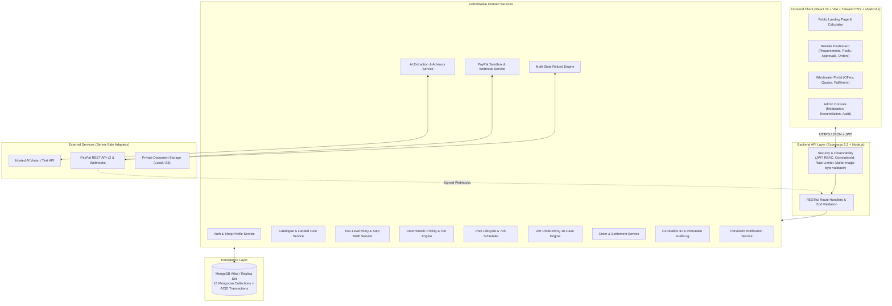

# Aap Ki Dukan (CoBuy AI) 🛒🤖

> **AI-Assisted B2B Group Procurement & Bulk-Order Coordination Platform for Independent Small Businesses**

[](https://opensource.org/licenses/ISC)
[](https://nodejs.org/)
[](https://react.dev/)
[](https://expressjs.com/)
[](https://www.mongodb.com/)
[-success.svg)](https://vitest.dev/)

---

## 📌 Executive Summary & Product Vision

Small independent businesses—kirana stores, retail shops, cafés, bakeries, and neighbourhood restaurants—frequently struggle to access wholesale discounts because they cannot individually meet steep **Wholesaler Minimum Order Quantities ($MOQ_W$)**.

**Aap Ki Dukan (CoBuy AI)** is a full-stack, production-grade B2B SaaS platform that enables small businesses to pool compatible purchasing requirements, qualify for wholesale volume tiers, transparently allocate landed and shipping costs, and coordinate group orders with automated financial protections.

### Core Architectural Philosophy
1. **AI as an Intelligent Assistant:** Hosted multimodal AI models extract structured product attributes from messy natural-language requests, invoices, PDFs (up to $10\text{ MB}$), or CSV imports; normalize specifications; explain attribute matches/mismatches with catalogue offers; summarize quote trade-offs; and generate data-grounded advisory recommendations when pools face sub-MOQ expiration.
2. **Deterministic Backend as the Single Source of Truth:** Pure deterministic backend logic governs all critical business calculations: Wholesaler MOQ ($MOQ_W$), Retailer MOQ ($MOQ_R = 20\%$), step multiples ($1\%$), quantity-tier pricing, shipping cost allocations, versioned pricing snapshots, 72-hour countdown timers, 24-hour under-MOQ decision engines, PayPal Sandbox payment captures, refunds, and order status transitions.
3. **Zero Decorative / Fake Functionality:** Every button, filter, calculation, and status badge is backed by persistent database records. Prototype sandbox transactions, mock datasets, and simulated payouts carry transparent, explicit disclosures (`TEST TRANSACTION — PAYPAL SANDBOX`, `DEMO SAMPLE DATA`, `SIMULATED SETTLEMENT`).

---

## 🚀 Key Features

### 1. 🤖 AI-Powered Requirement Intake & Normalization
* **Multimodal Intake:** Ingests requirements via structured forms, free-form text, invoice photos, PDF documents (up to $10\text{ MB}$), or bulk CSV uploads.
* **Intelligent Extraction:** Extracts product category, pack size, units, specifications, brand constraints, required-by dates, and delivery locations with uncertainty indicators.
* **Human-in-the-Loop Confirmation:** Shop owners review, edit, and explicitly verify AI-extracted fields with fallback manual entry if AI providers are unreachable.

### 2. 📊 Two-Level MOQ & Step-Multiple Math
* **Wholesaler MOQ ($MOQ_W$):** The minimum total threshold required by suppliers (e.g. $1,000\text{ units}$).
* **Retailer Minimum MOQ ($MOQ_R$):** Configurable minimum individual shop commitment (default $20\% \implies \min 200\text{ units}$ when $MOQ_W = 1,000$) to prevent free-riding.
* **Retailer Step Increment ($\text{Step}$):** Enforces order increments in uniform multiples (default $1\% \implies \text{multiples of } 10\text{ units}$).

### 3. ⏱️ 72-Hour Pool Timers & Automatic Early Lock
* **Authoritative Server Timer:** Every group-buy pool operates under a server-synced 72-hour recruitment countdown.
* **Immediate Early Lock:** When aggregate eligible pool quantity $Q_{\text{pool}}$ meets or exceeds $MOQ_W$ before 72 hours, the pool locks immediately, freezes an immutable versioned `PriceSnapshot`, and notifies all participants.

### 4. ⚖️ 24-Hour Under-MOQ 10-Case Decision Engine
* **Deterministic Expiry Resolution:** If 72 hours elapse with $Q_{\text{pool}} < MOQ_W$, the pool enters an authoritative 24-hour buyer decision window.
* **AI-Grounded Advisory:** Recommends the optimal course of action based on historical shortfall, price feasibility, and alternative supplier offers (`PROCEED`, `WAIT_FOR_REVISED_QUOTE`, `CANCEL`).
* **Strict Consent Rule:** Silence is never treated as consent. If buyers reject revised pricing or fail to respond within 24 hours, contributions are safely rolled back and refunded.

### 5. 💳 Fintech Orchestration, Webhooks & Idempotency
* **Server-Verified Captures (`FR-PAY-007`):** Browser redirects alone never credit contributions. All captures are authoritatively verified server-side against PayPal REST APIs.
* **Cryptographic Webhook Verification:** Incoming PayPal webhooks verify `PAYPAL-TRANSMISSION-SIG`, transmission IDs, and `PAYPAL_WEBHOOK_ID`.
* **Strict Concurrency Protection:** Atomic status locking protects against 5 identical concurrent capture requests and duplicate webhooks, ensuring contributions are never double-credited.
* **Network Timeout Reconciliation:** `reconcilePaymentState(paymentId)` queries provider order status to automatically recover payments stuck in `UNKNOWN` or `CAPTURE_PENDING`.

### 6. 💸 Multi-State Refund Engine
* **Four-Phase State Machine:** `REQUESTED` $\rightarrow$ `PROCESSING` $\rightarrow$ `COMPLETED` (or `FAILED`).
* **Supported Scenarios:** Full buyer withdrawals, partial quantity reductions, automatic tier-drop savings delta refunds, pool cancellations, and supplier rejections.
* **Automatic Tier-Drop Savings:** When early joiners pay an initial baseline price under `PAY_AT_JOIN` and the pool locks at a lower volume tier, the platform automatically calculates the savings delta and initiates a refund.

### 7. 🏭 Supplier Settlements & Purchase Order (PO) Generator
* **Strict Separation of Funds:** Buyer `Payment` captures and wholesaler payouts (`SupplierSettlement`) are strictly separated into independent models and lifecycles.
* **Printable PO Summary (`GET /api/orders/:id/po-summary`):** Generates structured JSON and printable HTML Purchase Orders containing order details, wholesaler information, itemized per-shop allocations, payment references, and sandbox disclaimers.

### 8. 🛡️ Security, Audit Logging & Notifications
* **Correlation Tracking:** `X-Correlation-Id` middleware generates/propagates UUIDs on every HTTP request/response for distributed tracing.
* **Immutable Audit Trail:** Append-only `AuditLog` collection records all critical state transitions with automatic redaction of passwords, tokens, and credit card numbers.
* **Fault-Isolated Notifications (FR-NOTIF-004):** In-app notification center supporting 19 lifecycle event types wrapped in non-throwing error boundaries so notification issues never abort financial transactions.

---

## 🏗️ System Architecture



---

## 🗄️ Database Collections (All 18 Models)

All monetary values are stored strictly as **integers in minor currency units** (e.g. Paise for `INR`, Cents for `USD`) to eliminate floating-point arithmetic errors.

| Model | File Location | Purpose & Domain Area |
|---|---|---|
| `User` | `src/models/User.model.js` | User accounts, hashed passwords, roles (`SHOP_OWNER`, `SUPPLIER`, `ADMIN`, `REVIEWER`). |
| `Shop` | `src/models/Shop.model.js` | Retailer business profiles, GSTIN, addresses, and delivery preferences. |
| `Supplier` | `src/models/Supplier.model.js` | Wholesaler directory profiles, service radius, and verification status. |
| `UploadedDocument` | `src/models/UploadedDocument.model.js` | Private invoices, receipts, and spec sheets with checksums and MIME validation. |
| `Requirement` | `src/models/Requirement.model.js` | Retailer purchase requirements (raw text, AI-extracted, and confirmed). |
| `Product` | `src/models/Product.model.js` | Canonical product catalogue specifications and standardized units. |
| `SupplierOffer` | `src/models/SupplierOffer.model.js` | Wholesaler bulk tiered pricing, $MOQ_W$, $MOQ_R$ percentages, and provenance badges. |
| `Quote` | `src/models/Quote.model.js` | Custom, negotiated, or revised quotes provided by wholesalers for pools. |
| `GroupBuyPool` | `src/models/GroupBuyPool.model.js` | Shared buying pools, 72h timers, target quantities, and lifecycle states. |
| `Contribution` | `src/models/Contribution.model.js` | Individual shop commitments, quantities, payment states, and savings deltas. |
| `PriceSnapshot` | `src/models/PriceSnapshot.model.js` | Immutable versioned pricing snapshots freezing per-shop breakdowns for approval. |
| `Payment` | `src/models/Payment.model.js` | PayPal Sandbox & Mock payment attempts, capture IDs, and idempotency keys. |
| `Refund` | `src/models/Refund.model.js` | Multi-state refunds (withdrawals, tier-drop savings, cancellations, rollbacks). |
| `Order` | `src/models/Order.model.js` | Final purchase orders created upon complete funding and approval. |
| `SupplierSettlement` | `src/models/SupplierSettlement.model.js` | Wholesaler payout records cleanly separated from buyer payment captures. |
| `Notification` | `src/models/Notification.model.js` | Persistent in-app notifications across 19 lifecycle event types. |
| `AuditLog` | `src/models/AuditLog.model.js` | Immutable audit trail with sensitive credential redaction. |
| `AIExecutionLog` | `src/models/AIExecutionLog.model.js` | Auditable history of AI extractions, prompts, latency, and token consumption. |

---

## 📂 Repository Directory Structure

```text
Aap-ki-dukaan/
├── backend/                               # Express.js REST API & Backend Engine
│   ├── src/
│   │   ├── config/
│   │   │   ├── env.js                     # Zod-validated environment schema
│   │   │   └── db.js                      # MongoDB connection & withTransaction() helper
│   │   ├── controllers/                   # Thin HTTP controllers (asyncHandler + APIResponse)
│   │   │   ├── auth.controller.js         # Register, login, refresh, logout, password reset
│   │   │   ├── pool.controller.js         # Pool creation, join, edit, decisions
│   │   │   ├── payment.controller.js      # Order creation, capture, webhooks, reconciliation
│   │   │   ├── refund.controller.js       # Refund initiation, tier-drop savings triggers
│   │   │   ├── order.controller.js        # Orders, PO summary generator, settlements
│   │   │   ├── notification.controller.js # Notifications list & read status
│   │   │   ├── supplier.controller.js     # Suppliers, products, catalogue offers
│   │   │   └── upload.controller.js       # File uploads & document metadata
│   │   ├── middleware/                    # Security, auth, logging & error middleware
│   │   │   ├── auth.middleware.js         # JWT verification & RBAC role guards
│   │   │   ├── correlationId.middleware.js# X-Correlation-Id generation & header propagation
│   │   │   ├── error.middleware.js        # Global safe error response handler
│   │   │   ├── rateLimiter.middleware.js  # Express rate limiting
│   │   │   └── upload.middleware.js       # Multer MIME/magic-byte checks (10MB limit)
│   │   ├── models/                        # 18 Mongoose models with validation & indexes
│   │   ├── routes/                        # Modular Express route declarations
│   │   ├── services/                      # Authoritative domain business logic
│   │   │   ├── ai/                        # AI adapter, prompt defense, advisory service
│   │   │   ├── clock/                     # Test-injectable ClockService (PRK-02)
│   │   │   ├── groupBuy/                  # Pool lifecycle & recalculation logic
│   │   │   ├── notifications/             # Notification dispatcher & AuditLog service
│   │   │   ├── orders/                    # Order fulfillment & PO summary generator
│   │   │   ├── payments/                  # PayPal Sandbox adapter & payment orchestration
│   │   │   ├── pricing/                   # Two-level MOQ validator & pricing engine
│   │   │   └── refunds/                   # Multi-state refund service & tier-drop math
│   │   ├── utils/                         # ApiError, ApiResponse, asyncHandler helpers
│   │   ├── app.js                         # Express application setup & middleware stack
│   │   └── index.js                       # Server entry point
│   ├── tests/
│   │   ├── integration/                   # Supertest + MongoMemoryServer integration tests
│   │   └── unit/                          # Pure business logic unit tests
│   └── package.json
├── client/                                # React 19 + Vite Frontend Workspace
│   ├── src/
│   │   ├── components/common/             # Reusable UI widgets (MOQStepCalculator, CountdownTimer, etc.)
│   │   ├── test/                          # Frontend unit & component test suites
│   │   ├── utils/                         # Monetary formatting (money.js) & MOQ math
│   │   ├── App.jsx                        # Main application component
│   │   └── main.jsx                       # React DOM entry point
│   ├── vite.config.js
│   └── package.json
├── Docs/                                  # Comprehensive architectural and design specifications
│   ├── database_schemas.md                # Full Mongoose schemas and data dictionary
│   ├── high_level_design (1).md           # High-Level Architecture (HLD) document
│   ├── low_level_design.md                # Low-Level Design (LLD) document
│   ├── master_execution_order_and_dependency_plan.md # 50-task implementation roadmap
│   └── website_description_and_unified_srs.md        # Unified master SRS v2.0
├── Srs.md                                 # Master System Requirements Specification
└── README.md                              # This document
```

---

## 🛠️ Getting Started

### Prerequisites
* **Node.js:** `v22.0.0` or higher (verified on Node.js v24)
* **npm:** `v10.0.0` or higher
* **MongoDB:** Local MongoDB instance, MongoDB Atlas URI, or `mongodb-memory-server` for offline testing

### 1. Clone the Repository
```bash
git clone https://github.com/rot44/Aap-ki-dukaan.git
cd Aap-ki-dukaan
```

### 2. Backend Setup
```bash
cd backend
npm install
```

Create a `.env` file in `backend/` (or copy from `.env.example`):
```env
PORT=5000
NODE_ENV=development
CLIENT_ORIGIN=http://localhost:5173
MONGODB_URI=mongodb://localhost:27017/aap_ki_dukaan

# JWT Authentication
JWT_ACCESS_SECRET=your_super_secret_access_key_min_32_characters_long
JWT_REFRESH_SECRET=your_super_secret_refresh_key_min_32_characters_long
JWT_ACCESS_EXPIRY=15m
JWT_REFRESH_EXPIRY=7d

# Two-Level MOQ Defaults
DEFAULT_RETAILER_MOQ_PERCENT=20
DEFAULT_RETAILER_STEP_PERCENT=1
DEFAULT_DECISION_WINDOW_HOURS=24

# Payment Engine (set to 'mock' for offline testing, or 'sandbox' for PayPal Sandbox)
PAYMENT_MODE=mock
PAYPAL_CLIENT_ID=your_paypal_sandbox_client_id
PAYPAL_CLIENT_SECRET=your_paypal_sandbox_client_secret
PAYPAL_WEBHOOK_ID=WH-MOCK-WEBHOOK-12345

# AI Provider (set to 'mock' for offline testing, or 'gemini' / 'openai' for live AI)
AI_PROVIDER=mock
AI_API_KEY=mock_ai_api_key
AI_MODEL=gemini-1.5-flash
AI_TIMEOUT_MS=15000

# Private Document Uploads
UPLOAD_DIR=./uploads
MAX_UPLOAD_SIZE_MB=10
```

Start the backend development server:
```bash
npm run dev
```
The backend API will start at `http://localhost:5000`. Test health status at `http://localhost:5000/api/health`.

### 3. Frontend Setup
```bash
cd ../client
npm install
npm run dev
```
The React frontend will be accessible at `http://localhost:5173`.

---

## 🧪 Automated Testing & Verification

The project enforces strict test-driven development (TDD) across all backend services, routes, and frontend widgets. Tests run in an isolated in-memory MongoDB instance (`mongodb-memory-server`) with zero external network dependencies.

### Running Backend Tests
```bash
cd backend
npm test
```
**Test Coverage:** 221 tests passing across 23 test suites:
```text
 ✓ tests/unit/pricing.test.js (8 tests)
 ✓ tests/unit/moqValidator.test.js (11 tests)
 ✓ tests/unit/clock.test.js (7 tests)
 ✓ tests/unit/paymentIdempotency.test.js (42 tests)
 ✓ tests/unit/underMoqAdvisory.test.js (7 tests)
 ✓ tests/unit/aiAdapter.test.js (10 tests)
 ✓ tests/unit/withTransaction.test.js (3 tests)
 ✓ tests/unit/snapshot.test.js (4 tests)
 ✓ tests/integration/auth.test.js (17 tests)
 ✓ tests/integration/shopProfile.test.js (7 tests)
 ✓ tests/integration/poolLifecycle.test.js (5 tests)
 ✓ tests/integration/poolTimer.test.js (2 tests)
 ✓ tests/integration/poolRoutes.test.js (2 tests)
 ✓ tests/integration/underMoqCases.test.js (10 tests)
 ✓ tests/integration/catalogue.test.js (10 tests)
 ✓ tests/integration/upload.test.js (7 tests)
 ✓ tests/integration/paymentsRefunds.test.js (23 tests)
 ✓ tests/integration/refundEngine.test.js (9 tests)
 ✓ tests/integration/orderPoSummary.test.js (10 tests)
 ✓ tests/integration/supplierSettlement.test.js (8 tests)
 ✓ tests/integration/notificationCenter.test.js (10 tests)
 ✓ tests/integration/auditLogCorrelation.test.js (8 tests)
 ✓ tests/integration/health.test.js (1 test)

 Test Files  23 passed (23)
      Tests  221 passed (221)
```

### Running Frontend Tests
```bash
cd client
npm test
```
**Test Coverage:** 46 tests passing across 3 test suites:
```text
 ✓ src/test/components.test.jsx (13 tests)
 ✓ src/test/suj01.test.jsx (27 tests)
 ✓ src/test/landingPage.test.jsx (6 tests)

 Test Files  3 passed (3)
      Tests  46 passed (46)
```

---

## 🌐 API Reference Overview

| Endpoint | Method | Role / Auth | Description |
|---|---|---|---|
| `/api/health` | `GET` | Public | Server uptime, environment, and MongoDB connection status. |
| `/api/auth/register` | `POST` | Public | Registers a new retailer shop owner or supplier. |
| `/api/auth/login` | `POST` | Public | Authenticates credentials and returns JWT access + refresh tokens. |
| `/api/shops/me` | `GET` / `PATCH` | `SHOP_OWNER` | Inspect and update authenticated retailer's business profile. |
| `/api/suppliers` | `GET` | Authenticated | Browse active verified wholesalers filtered by service area. |
| `/api/suppliers/:id/offers` | `GET` | Authenticated | Retrieve tiered offers, $MOQ_W$, and step increment rules. |
| `/api/pools` | `GET` / `POST` | Authenticated | Discover public group-buy pools or create a new pool. |
| `/api/pools/:id/contributions` | `POST` | `SHOP_OWNER` | Join an open pool with verified quantity matching $MOQ_R$ & Step. |
| `/api/pools/:id/decision` | `POST` | `SHOP_OWNER` | Submit `PROCEED` or `CANCEL` during 24h under-MOQ window. |
| `/api/payments/create-order` | `POST` | `SHOP_OWNER` | Creates server-computed PayPal order (client cannot supply amounts). |
| `/api/payments/:id/capture` | `POST` | `SHOP_OWNER` | Server-side capture verification; the only path that marks payments `PAID`. |
| `/api/payments/webhook` | `POST` | Public / PayPal | Cryptographically verified PayPal webhook event ingestion. |
| `/api/payments/:id/reconcile` | `POST` | Authenticated | Reconciles payments stuck in `UNKNOWN` or `CAPTURE_PENDING`. |
| `/api/refunds/initiate` | `POST` | `SHOP_OWNER` / `ADMIN` | Initiates full withdrawal or partial quantity-reduction refund. |
| `/api/refunds/tier-drop-savings` | `POST` | `ADMIN` / Scheduler | Automatically calculates and disburses bulk tier-drop savings refunds. |
| `/api/orders/:id/po-summary` | `GET` | Participant / Admin | Download structured, printable HTML/JSON Purchase Order summary. |
| `/api/orders/:id/activity` | `GET` | Participant / Admin | Chronological audit trail and timeline of order lifecycle events. |
| `/api/notifications` | `GET` | Authenticated | Paginated in-app notifications with unread count. |

---

## 👥 Personas & Role-Based Access Control

The platform enforces strict role-based access control (RBAC):
* **`SHOP_OWNER` (Retailer):** Manages shop business profile, submits purchasing requirements, joins/edits group-buy pools, approves price snapshots, completes checkout, and downloads POs.
* **`SUPPLIER` (Wholesaler):** Manages wholesale catalogue offers, configures bulk price tiers and $MOQ_W$, issues custom/revised quotes, and confirms PO shipments.
* **`ADMIN` (Platform Administrator):** Moderates suppliers, manages stalled pools, triggers bulk tier-drop reconciliations, inspects audit logs, and handles exception cases.
* **`REVIEWER` (Read-Only Evaluator):** Read-only inspection access for platform evaluation and hackathon judging with zero mutation privileges.

---

## 📄 License

This project is licensed under the terms of the **ISC License**.
Copyright © 2026 Aap Ki Dukan (CoBuy AI). All rights reserved.
