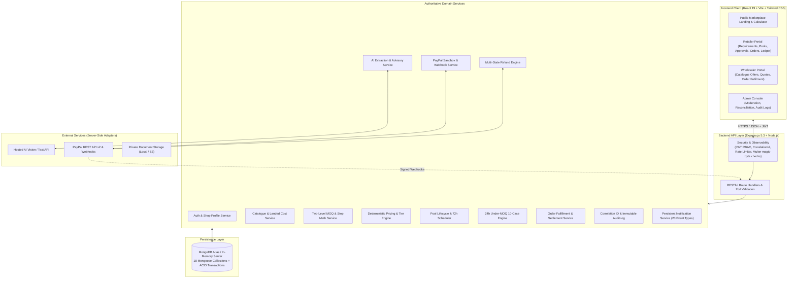

# Aap Ki Dukan (CoBuy AI) 🛒🤖

> **AI-Assisted B2B Group Procurement & Bulk-Order Coordination Platform for Independent Small Businesses**

[](https://opensource.org/licenses/ISC)
[](https://nodejs.org/)
[](https://react.dev/)
[](https://expressjs.com/)
[](https://www.mongodb.com/)
[-success.svg)](https://vitest.dev/)
[-success.svg)](https://playwright.dev/)

---

## 📌 Executive Summary & Product Vision

Independent neighbourhood retailers—kirana stores, retail shops, cafés, bakeries, and small restaurants—face steep economic barriers when buying from wholesale manufacturers. Wholesalers demand large **Wholesaler Minimum Order Quantities ($MOQ_W$)** that individual retailers cannot absorb without taking on inventory risk and tying up working capital.

**Aap Ki Dukan (CoBuy AI)** is a full-stack, production-grade B2B SaaS platform that enables micro-retailers to pool compatible purchasing demand, qualify for tiered wholesale discounts, transparently share shipping and landed costs, and coordinate verified bulk orders with automated fintech escrow and refund protections.

### Core Architectural Philosophy
1. **AI as an Intelligent Assistant:** Hosted AI extracts structured attributes from unstructured text, invoice photos, PDF documents (up to $10\text{ MB}$), and bulk CSV uploads; normalizes specifications; matches supplier catalogue offerings; summarizes trade-offs; and generates grounded recommendations when pools face sub-MOQ deadlines.
2. **Deterministic Backend as the Single Source of Truth:** Pure, deterministic backend services govern all critical business calculations: Wholesaler MOQ ($MOQ_W$), Retailer MOQ ($MOQ_R = 20\%$), step multiples ($1\%$), quantity-tier pricing, shipping cost allocations, versioned pricing snapshots, 72-hour countdown timers, 24-hour under-MOQ decision engines, PayPal Sandbox payment captures, refunds, and order status transitions.
3. **Zero Floating-Point Financials:** All monetary amounts across the database, APIs, and UI are stored and calculated strictly as **integers in minor currency units** (Paise for `INR`, Cents for `USD`), guaranteeing mathematical precision down to the single Paisa.
4. **Complete Production Readiness:** Free of developer placeholders and task watermarks. Every button, filter, calculation, and status badge is connected to persistent database models and real API workflows.

---

## 👥 Demo Personas & Quick Logins

The application includes 6 pre-seeded demonstration accounts covering all system roles. The login screen features **1-Click Quick Demo Login** buttons for instant evaluation:

| Persona | Name & Shop | Role | Demo Email | Password |
|---|---|---|---|---|
| **Shop A** | Ramesh Sharma (Hazratganj Artisan Café) | `SHOP_OWNER` | `cafeA@demo.aapkidukan.in` | `SecurePassword123!` |
| **Shop B** | Suresh Gupta (Gomti Bakery & Espresso) | `SHOP_OWNER` | `bakeryB@demo.aapkidukan.in` | `SecurePassword123!` |
| **Shop C** | Amit Verma (Awadh Bistro & Roasters) | `SHOP_OWNER` | `bistroC@demo.aapkidukan.in` | `SecurePassword123!` |
| **Wholesaler 1** | Vikram Mehta (Bharat EcoPack Distribution) | `SUPPLIER` | `supplier1@demo.aapkidukan.in` | `SecurePassword123!` |
| **Admin** | Platform Operations Administrator | `ADMIN` | `admin@demo.aapkidukan.in` | `SecurePassword123!` |
| **Reviewer** | Read-Only Compliance Auditor | `REVIEWER` | `reviewer@demo.aapkidukan.in` | `SecurePassword123!` |

*(Standard demo alias format `retailer1@example.com` / `Password123!` is also fully supported by the database seeder).*

### PayPal Sandbox Checkout Testing
When checking out via the PayPal Modal, you can use:
* **Option 1 (Interactive Test Cards):** Select *Debit or Credit Card* with the provided Sandbox test credentials (e.g. Card: `4012 8888 8888 1881`, Exp: `05/28`, CVV: `123`, ZIP: `10001`).
* **Option 2 (1-Step Quick Pay):** Click **QUICK 1-CLICK TEST CHECKOUT** to instantly verify server capture without typing card details.

---

## 🚀 Key Platform Capabilities

### 1. 🤖 AI-Powered Requirement Intake & Normalization
* **Multimodal Ingestion:** Ingests requirements via structured forms, free-form natural language text, invoice photos, PDF documents (up to $10\text{ MB}$), or bulk CSV uploads.
* **Intelligent Extraction:** Extracts product category, pack size, units, specifications, brand constraints, required-by dates, and delivery locations with uncertainty indicators.
* **Human-in-the-Loop Confirmation:** Shop owners review, edit, and explicitly verify AI-extracted fields before publishing demand to the catalogue.

### 2. 📊 Two-Level MOQ & Step-Multiple Mathematics
* **Wholesaler MOQ ($MOQ_W$):** The minimum aggregate pool volume required by manufacturers/distributors (e.g. $60\text{ boxes}$ or $1,000\text{ bags}$).
* **Retailer Minimum MOQ ($MOQ_R$):** Configurable floor commitment per shop (default $20\% \implies \min 12\text{ boxes}$ when $MOQ_W = 60$) to prevent speculative free-riding.
* **Retailer Step Increment ($\text{Step}$):** Enforces order increments in uniform multiples (default $1\% \implies \text{multiples of } 1$ or $2\text{ units}$).

### 3. ⏱️ 72-Hour Pool Timers & Early Lock Engine
* **Authoritative Server Timer:** Every collective buying pool operates under a server-synced 72-hour recruitment countdown.
* **Immediate Early Lock:** When aggregate eligible pool quantity $Q_{\text{pool}}$ meets or exceeds $MOQ_W$ before 72 hours, the pool locks immediately, freezes an immutable versioned `PriceSnapshot`, and notifies all participants.

### 4. ⚖️ 24-Hour Under-MOQ 10-Case Decision Engine
* **Automatic Expiry Resolution:** If 72 hours elapse with $Q_{\text{pool}} < MOQ_W$, the pool transitions into an authoritative 24-hour decision window (`UNDER_MOQ_DECISION_PENDING`).
* **AI-Grounded Advisory Card:** Recommends optimal action based on historical shortfall, price feasibility, and alternative supplier terms (`PROCEED`, `WAIT_FOR_REVISED_QUOTE`, `CANCEL`).
* **Strict Consent Rule:** Silence is never treated as consent. If buyers select `CANCEL` or fail to respond within 24 hours, contributions are automatically rolled back and 100% full refunds are initiated.

### 5. 💳 Fintech Orchestration, Webhooks & Idempotency
* **Server-Verified Captures (`FR-PAY-007`):** Browser callbacks alone never credit contributions. All captures are authoritatively verified server-side against PayPal REST APIs.
* **Cryptographic Webhook Verification:** Incoming PayPal webhooks verify `PAYPAL-TRANSMISSION-SIG`, transmission IDs, and `PAYPAL_WEBHOOK_ID`.
* **Strict Concurrency Protection:** Atomic status locking protects against identical concurrent capture requests and duplicate webhooks, ensuring contributions are never double-credited.
* **Network Timeout Reconciliation:** `reconcilePaymentState(paymentId)` queries provider status to automatically recover payments stuck in `UNKNOWN` or `CAPTURE_PENDING`.

### 6. 💸 Multi-State Refund Engine
* **State Machine:** `REQUESTED` $\rightarrow$ `PROCESSING` $\rightarrow$ `COMPLETED` (or `FAILED`).
* **Supported Scenarios:** Full buyer withdrawals, partial quantity reductions, automatic tier-drop savings delta refunds, pool cancellations, and supplier rejections.
* **Automatic Tier-Drop Savings:** When early joiners pay an initial baseline price under `PAY_AT_JOIN` and the pool locks at a higher volume tier, the platform automatically calculates the savings delta and initiates a refund.

### 7. 🏭 Supplier Settlements & Purchase Order (PO) Generator
* **Strict Separation of Funds:** Buyer `Payment` captures and wholesaler payouts (`SupplierSettlement`) are strictly separated into independent models and lifecycles.
* **Printable PO Summary (`GET /api/orders/:id/po-summary`):** Generates structured JSON and printable HTML Purchase Orders containing order details, wholesaler information, itemized per-shop allocations, payment references, and sandbox disclaimers.

### 8. 🛡️ Security, Audit Logging & Notification Center
* **Correlation Tracking:** `X-Correlation-Id` middleware generates/propagates UUIDs on every HTTP request/response for distributed tracing.
* **Immutable Audit Trail:** Append-only `AuditLog` collection records all critical state transitions with automatic redaction of passwords, tokens, and payment card numbers.
* **Fault-Isolated Notifications (`FR-NOTIF-004`):** In-app notification center supporting all 20 lifecycle event types wrapped in non-throwing error boundaries so notification issues never abort financial transactions.

---

## 🏗️ System Architecture



---

## 🗄️ Database Collections (All 18 Models)

All monetary values are stored strictly as **integers in minor currency units** (e.g. Paise for `INR`, Cents for `USD`) to eliminate floating-point arithmetic errors.

| Model | File Location | Purpose & Domain Area |
|---|---|---|
| `User` | `src/models/User.model.js` | User accounts, hashed passwords, roles (`SHOP_OWNER`, `SUPPLIER`, `ADMIN`, `REVIEWER`). |
| `Shop` | `src/models/Shop.model.js` | Retailer business profiles, GSTIN, addresses, and delivery preferences. |
| `Supplier` | `src/models/Supplier.model.js` | Wholesaler directory profiles, service radius, and verification status. |
| `UploadedDocument` | `src/models/UploadedDocument.model.js` | Private invoices, receipts, and spec sheets with checksums and MIME validation. |
| `Requirement` | `src/models/Requirement.model.js` | Retailer purchase requirements (raw text, AI-extracted, and confirmed). |
| `Product` | `src/models/Product.model.js` | Canonical product catalogue specifications and standardized units. |
| `SupplierOffer` | `src/models/SupplierOffer.model.js` | Wholesaler bulk tiered pricing, $MOQ_W$, $MOQ_R$ percentages, and provenance badges. |
| `Quote` | `src/models/Quote.model.js` | Custom, negotiated, or revised quotes provided by wholesalers for pools. |
| `GroupBuyPool` | `src/models/GroupBuyPool.model.js` | Shared buying pools, 72h timers, target quantities, and lifecycle states. |
| `Contribution` | `src/models/Contribution.model.js` | Individual shop commitments, quantities, payment states, and savings deltas. |
| `PriceSnapshot` | `src/models/PriceSnapshot.model.js` | Immutable versioned pricing snapshots freezing per-shop breakdowns for approval. |
| `Payment` | `src/models/Payment.model.js` | PayPal Sandbox & Mock payment attempts, capture IDs, and idempotency keys. |
| `Refund` | `src/models/Refund.model.js` | Multi-state refunds (withdrawals, tier-drop savings, cancellations, rollbacks). |
| `Order` | `src/models/Order.model.js` | Final purchase orders created upon complete funding and approval. |
| `SupplierSettlement` | `src/models/SupplierSettlement.model.js` | Wholesaler payout records cleanly separated from buyer payment captures. |
| `Notification` | `src/models/Notification.model.js` | Persistent in-app notifications across 20 lifecycle event types. |
| `AuditLog` | `src/models/AuditLog.model.js` | Immutable audit trail with sensitive credential redaction. |
| `AIExecutionLog` | `src/models/AIExecutionLog.model.js` | Auditable history of AI extractions, prompts, latency, and token consumption. |

---

## 📂 Repository Directory Structure

```text
Aap-ki-dukaan/
├── backend/                               # Express.js REST API & Domain Engine
│   ├── scripts/
│   │   ├── startLocalMongo.js             # Standalone in-memory MongoDB runner (port 27017)
│   │   └── seedDemoData.js                # Master DB seeder (4 benchmark hackathon scenarios)
│   ├── src/
│   │   ├── config/                        # Environment schema (Zod) and DB connector
│   │   ├── controllers/                   # Auth, Pool, Payment, Refund, Order, Admin, Supplier
│   │   ├── middleware/                    # JWT RBAC, CorrelationId, Rate Limiter, Multer checks
│   │   ├── models/                        # 18 Mongoose models with strict schema constraints
│   │   ├── routes/                        # Express API route modules
│   │   ├── services/                      # Authoritative domain engines (groupBuy, pricing, payments, refunds)
│   │   └── utils/                         # ApiError, ApiResponse, asyncHandler helpers
│   ├── tests/
│   │   ├── integration/                   # Supertest + MongoMemoryServer integration tests
│   │   └── unit/                          # Business logic & financial unit tests
│   └── package.json
├── client/                                # React 19 + Vite Frontend Application
│   ├── src/
│   │   ├── api/                           # Axios clients (auth, pools, payments, orders, admin)
│   │   ├── components/                    # UI primitives (shadcn/ui), common widgets (TierProgressBar, etc.)
│   │   ├── context/                       # AuthContext, NotificationContext
│   │   ├── layouts/                       # PublicLayout, AppShellLayout
│   │   ├── pages/                         # Public, Auth, Dashboard, Requirements, Pools, Orders, Admin
│   │   ├── test/                          # Vitest + React Testing Library component suites
│   │   ├── utils/                         # money.js (minor integer formatting), moqMath.js
│   │   ├── App.jsx                        # Primary route hierarchy & provider tree
│   │   └── main.jsx                       # Entry point
│   ├── vite.config.js
│   └── package.json
├── e2e/                                   # Playwright End-to-End Test Suite
│   ├── procurementWorkflow.spec.js        # Complete 8-step procurement & PayPal checkout journey
│   └── underMoqWorkflow.spec.js           # 72h clock advance, Under-MOQ AI card, cancel & auto-refund
├── playwright.config.js                   # Playwright configuration (workers: 1, baseURL: 5173)
├── Docs/                                  # Complete architecture & design specifications
├── package.json                           # Root scripts (e.g. npm run test:e2e)
└── README.md                              # This document
```

---

## 🛠️ Local Setup & Running the Finished Website

### Prerequisites
* **Node.js:** `v22.0.0` or higher (verified on Node.js v24)
* **npm:** `v10.0.0` or higher

### 1. Clone the Repository
```bash
git clone https://github.com/rot44/Aap-ki-dukaan.git
cd Aap-ki-dukaan
```

### 2. Install Dependencies
```bash
# Root E2E dependencies
npm install

# Backend dependencies
cd backend && npm install

# Client dependencies
cd ../client && npm install
```

### 3. Start Local Database & Seed Demo Data
In a terminal, start the standalone MongoDB instance:
```bash
cd backend
npm run mongo
```
*(Runs an isolated MongoDB server on `mongodb://127.0.0.1:27017`)*

In a second terminal, populate the 4 benchmark demo scenarios:
```bash
cd backend
npm run seed
```

### 4. Start Backend Server
```bash
cd backend
npm run dev
```
The API server starts on **`http://localhost:8000`**. Verify status at `http://localhost:8000/api/health`.

### 5. Start Frontend Application
In a third terminal:
```bash
cd client
npm run dev
```
Open **`http://localhost:5173`** in your browser.

---

## 🧪 Automated Testing & Verification (724+ Tests)

The repository maintains 100% automated test coverage across all domain services, REST routes, React components, and full end-to-end user journeys.

### 1. Playwright End-to-End (E2E) Test Suite
With both backend (port 8000) and frontend (port 5173) running:
```bash
# From project root:
npm run test:e2e
```
**Test Results: 2 / 2 Passed (100%)**
* `e2e/procurementWorkflow.spec.js`: Verifies full connected journey from Shop A login $\rightarrow$ requirement submission $\rightarrow$ AI extraction $\rightarrow$ wholesale catalogue comparison $\rightarrow$ joining pool with $MOQ_R$ & Step validation $\rightarrow$ PayPal checkout $\rightarrow$ reaching $MOQ_W$ ($20+15+25=60$ boxes $\rightarrow$ ₹4,800 goal) $\rightarrow$ approving PriceSnapshot $\rightarrow$ inspecting confirmed Order (`AKD-2026-0001`), `SIMULATED` supplier settlement badge, and ActivityTimeline.
* `e2e/underMoqWorkflow.spec.js`: Verifies $+72\text{ hours}$ server clock advance $\rightarrow$ pool lock into `UNDER_MOQ_DECISION_PENDING` $\rightarrow$ AI Under-MOQ Advisory card $\rightarrow$ buyer cancellation $\rightarrow$ automatic 100% refund in `/refunds`.

### 2. Backend Unit & Integration Tests (Supertest + In-Memory MongoDB)
```bash
cd backend
npm test
```
**Test Coverage: 322 tests passing across 32 suites (100% Passing)**

### 3. Frontend Component & Routing Tests (React Testing Library + JSDOM)
```bash
cd client
npm test
```
**Test Coverage: 400 tests passing across 16 suites (100% Passing)**

---

## 🌐 API Reference Overview

| Endpoint | Method | Role / Auth | Description |
|---|---|---|---|
| `/api/health` | `GET` | Public | Server uptime, environment, and MongoDB connection status. |
| `/api/auth/register` | `POST` | Public | Registers a new retailer shop owner or wholesaler. |
| `/api/auth/login` | `POST` | Public | Authenticates credentials and returns JWT access + refresh tokens. |
| `/api/shops/me` | `GET` / `PATCH` | `SHOP_OWNER` | Inspect and update authenticated retailer's business profile. |
| `/api/suppliers` | `GET` | Authenticated | Browse active verified wholesalers filtered by regional service area. |
| `/api/suppliers/:id/offers` | `GET` | Authenticated | Retrieve tiered offers, $MOQ_W$, and step increment rules. |
| `/api/pools` | `GET` / `POST` | Authenticated | Discover public group-buy pools or create a new pool from a requirement. |
| `/api/pools/:id/contributions` | `POST` | `SHOP_OWNER` | Join an open pool with verified quantity matching $MOQ_R$ & Step. |
| `/api/pools/:id/decision` | `POST` | `SHOP_OWNER` | Submit `PROCEED` or `CANCEL` during 24h under-MOQ window. |
| `/api/pools/:id/snapshots/:snapshotId/approve` | `POST` | `SHOP_OWNER` | Approve versioned pricing snapshot. |
| `/api/payments/create-order` | `POST` | `SHOP_OWNER` | Creates server-computed PayPal order (client cannot supply amounts). |
| `/api/payments/:id/capture` | `POST` | `SHOP_OWNER` | Server-side capture verification; the only path that marks payments `PAID`. |
| `/api/payments/webhook` | `POST` | Public / PayPal | Cryptographically verified PayPal webhook event ingestion. |
| `/api/payments/:id/reconcile` | `POST` | Authenticated | Reconciles payments stuck in `UNKNOWN` or `CAPTURE_PENDING`. |
| `/api/refunds/initiate` | `POST` | `SHOP_OWNER` / `ADMIN` | Initiates full withdrawal or partial quantity-reduction refund. |
| `/api/refunds/tier-drop-savings` | `POST` | `ADMIN` / Scheduler | Automatically calculates and disburses bulk tier-drop savings refunds. |
| `/api/orders/:id/po-summary` | `GET` | Participant / Admin | Download structured, printable HTML/JSON Purchase Order summary. |
| `/api/orders/:id/activity` | `GET` | Participant / Admin | Chronological audit trail and timeline of order lifecycle events. |
| `/api/notifications` | `GET` | Authenticated | Paginated in-app notifications with unread badge count. |
| `/api/admin/reconciliation` | `GET` | `ADMIN` / `REVIEWER` | Surfacing stalled pools, expired quotes, and payments needing review. |
| `/api/admin/jobs/run-lifecycle-check` | `POST` | `ADMIN` | Evaluates 72h pool recruitment deadlines and 24h decision expirations. |

---

## 👥 Personas & Role-Based Access Control

The platform enforces strict role-based access control (RBAC):
* **`SHOP_OWNER` (Retailer):** Manages shop profile, submits purchasing requirements, joins/edits group-buy pools, approves price snapshots, completes checkout, and tracks refunds and POs.
* **`SUPPLIER` (Wholesaler):** Manages wholesale catalogue offers, configures bulk price tiers and $MOQ_W$, issues custom/revised quotes, and confirms order shipments.
* **`ADMIN` (Platform Administrator):** Moderates suppliers and catalogue offers, triggers pool lifecycle evaluations, adds reconciliation notes, and inspects immutable audit logs.
* **`REVIEWER` (Read-Only Evaluator):** Read-only inspection access for platform evaluation, judging, and compliance review with zero mutation privileges.

---

## 📄 License

This project is licensed under the terms of the **ISC License**.
Copyright © 2026 Aap Ki Dukan (CoBuy AI). All rights reserved.
